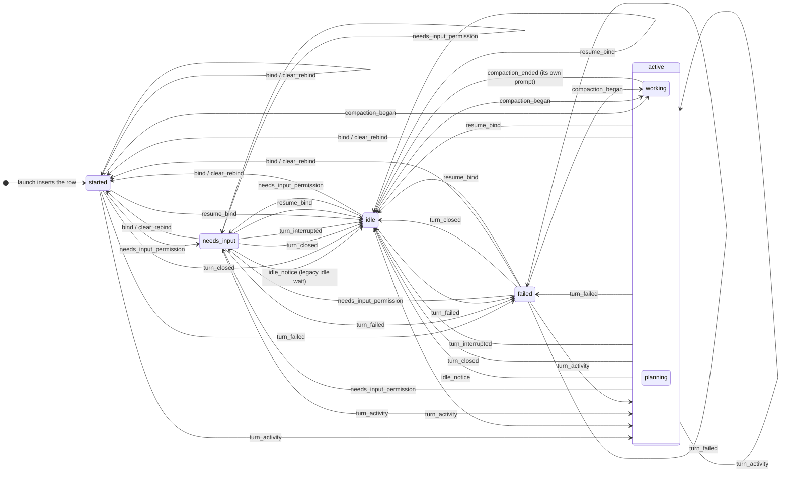

A Muster session is one `claude` process the daemon launched into its own tmux session.
Its identity is the tmux target; the Claude `session_id` is a mutable attribute that
`/clear` replaces in the same pane (kb:adr/lifecycle-session-identity-is-tmux-target,
kb:fact/clear-mints-new-session-id). The row is described in kb:ref/data-model.

## States

Six displayed states (`kb:anchor/state.displayed`): `started` (nothing has
happened yet), `planning` (mid-turn with the permission-mode latch on `plan`), `working`
(mid-turn), `needs_input` (a permission prompt is waiting, with `attention.reason`
and `attention.since`; an `idle` reason survives only on a row an earlier daemon persisted), `failed` (a turn ended in an error, with the raw error token and
message) and `idle` (a turn finished, with `lastActivity`, `lastPrompt` and `unread`, set when the turn
closed with no terminal client attached — kb:adr/rail-unread-inferred-from-live-terminal-client).
There is deliberately no
"Done": Claude Code knows a turn ended, not that a task completed (docs/design/ux-flows.md).
Liveness is an orthogonal `alive` flag, never a seventh state
(kb:adr/lifecycle-alive-flag-not-a-state): a dead session keeps its last state.

## Inputs

State is derived only from ingested hook events, launch and resume, tmux pane
liveness and, for interrupts (no hook), the transcript's interrupt line, read each poll tick
while a turn is open, closing it into `idle` (kb:adr/lifecycle-interrupt-read-from-transcript, kb:fact/interrupt-recorded-in-transcript).
Terminal output is never a state source; the machine sees no payload vocabulary, only the adapter's neutral input kinds. `Stop` closes a turn into `idle`; `StopFailure` closes it into `failed`
(kb:fact/stopfailure-replaces-stop). `PermissionRequest` and a `permission_prompt` enter
`needs_input` (kb:fact/notification-types-observed). An `idle_prompt` never does: naming an open
prompt of a `working` or `planning` session, it ends the turn into `idle` like `Stop`; otherwise
it only closes that prompt (kb:adr/lifecycle-idle-prompt-ends-turn-never-attention,
kb:fact/local-command-orphan-idle-prompt); one with no prompt id follows `/clear` and changes
nothing (kb:fact/clear-idle-prompt-carries-no-prompt-id).
Turn-activity events (`UserPromptSubmit`, `PreToolUse`, `PostToolUse`, `PostToolBatch`) enter `working` or
`planning` and clear attention and failure. A `PreCompact` outside a turn enters `working` and its compact
`SessionStart` lands `idle`; inside a turn it only counts
(kb:adr/lifecycle-compaction-reads-working, kb:fact/compact-hook-sequence). A compact
`SessionStart` is not a binder: it takes `Apply`'s envelope check like any non-bind event, so a
new unseen `session_id` forward-rebinds and one already left is a straggler, never a backwards
rebind (kb:adr/lifecycle-compaction-end-monotonic); on the bound id it records the model. An Esc before any output leaves the card `working` until the
next prompt (kb:adr/lifecycle-early-interrupt-gap-accepted,
kb:fact/interrupt-before-output-leaves-no-trace). `backgroundTasks` counts the background work the
latest `Stop` reported running, never a state input (kb:adr/lifecycle-background-tasks-count-not-state).
`SessionEnd` changes no state and never writes `alive` (kb:fact/sessionend-reason-ambiguous). The permission mode is a last-known latch seeded by the launch form and overwritten by any **main-agent** event that
carries the field; events without it never reset it, and a subagent's never move it
(kb:fact/permission-mode-presence-split, kb:adr/lifecycle-mode-latch-main-agent-only,
kb:fact/subagent-declared-mode-on-hooks). A subagent's `StopFailure` changes nothing
(kb:adr/lifecycle-subagent-stopfailure-not-session-failure).
The table is `kb:anchor/state.transitions`; tracked variables `kb:anchor/state.tracked`.

## The machine

Each transition is one `applyInput` arm in `internal/session/machine.go`, keyed on the
neutral kind. The latch picks planning while the permission mode reads plan, else
working. A bind or resume_bind with a different Claude session id escalates to clear_rebind
(started). turn_interrupted lands only from an open turn (working, planning or needs_input).
idle_notice ends the turn only from working, planning or a legacy idle wait; compaction_ended
lands idle only for its compaction's own open prompt. death_hint, clear_death_hint and inert change no state. A permission wait remembers its raising agent
(kb:adr/lifecycle-attention-owned-by-raising-agent): another agent's turn activity changes no
state, and a main `Stop` does not end a subagent's wait (kb:fact/subagent-hooks-during-permission-wait).

## Ordering and loss

Events apply in ingest `seq` order (kb:adr/ingest-seq-assigned-at-ingest). A Stop-family
event closes its `prompt_id`; an unmarked later event for a closed prompt is a straggler
that changes nothing, while a subagent-marked one moves the session back to active without
reopening the prompt (kb:adr/lifecycle-prompt-ordering-guards,
kb:adr/lifecycle-subagent-marked-events-not-stragglers, kb:fact/subagent-hooks-carry-agent-id).
A clear-rebind keeps the closed prompt ids, so old stragglers stay inert.
Any unseen `prompt_id` starts a turn, so every transition self-heals a lost predecessor.
Delivery is lossy and unordered (kb:fact/hook-delivery-best-effort); the machine never waits
for an event (`kb:anchor/state.ordering`).

## Liveness, reconcile, shutdown

`alive` is decided by pane existence on the muster socket, polled and nudged by PTY EOF and End
(kb:adr/lifecycle-liveness-from-pane-existence, `kb:anchor/state.liveness`). Once shutdown
begins, the poll and the PTY-EOF nudge stop persisting `alive=false`; the on-exit policy or the
next reconcile decides (kb:adr/lifecycle-liveness-writes-stop-at-shutdown). Reconcile at start runs before the
first snapshot: ended rows are deleted, live rows whose pane is gone are marked ended and kept
for one resume, unknown `muster-` names are logged, never adopted; shells are killed
(kb:adr/lifecycle-reconcile-before-first-snapshot, kb:adr/lifecycle-ended-rows-swept-next-start).
Resume relaunches a dead session with `--resume` in a fresh pane under the same row;
its `SessionStart` rebinds it into `idle`
(kb:adr/lifecycle-resume-rebinds-existing-session, kb:fact/resume-keeps-session-identity).
Shutdown leaves sessions running by default; `-on-exit` offers ask, leave and kill; kill also
kills every shell, leave leaves them running (kb:adr/lifecycle-shutdown-leaves-sessions-running,
kb:adr/surfaces-shell-dies-at-kill-shutdown-too).

## Wire

Every change broadcasts the whole Session (`kb:anchor/ws.session`,
`kb:anchor/ws.session-upsert`); the client replaces by id. Status
posts refresh title, model, context and Claude's directory (kb:spec/card-location), never a state-machine field.
