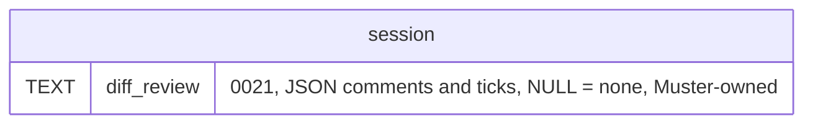
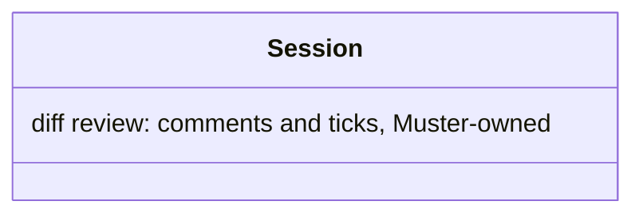

# Plan: diff-viewer

**Created**: 2026-11-19
**Status**: completed
**Work Type**: full-stack
**E2E Scope**: new-specs
**Fixture plan**: diff.spec.ts daemon (tests restart the daemon, end a session and assert what an ended session shows); diff-review.spec.ts daemon (tests restart the daemon to prove comments and ticks keep, and remove a session)
**Render fixtures**: new: diff (one idle session, focused, in a git checkout on branch `feature` off `main` with a committed change, plus uncommitted: a modified file with a one-word change in a long line and a multi-line change, an untracked added file, a deleted file, a staged `git mv` rename, a binary file; its review holds an open single-line comment, an open range comment, a resolved comment, an outdated comment and two ticked changes; recorded with the summary, both scopes' diffs and the review), new: diff-light (diff with `prefs.theme` light), new: diff-dark (diff with `prefs.theme` dark), new: diff-branch-only (a checkout whose only difference is a commit since `main`, no comments), new: diff-clean (a clean checkout, no comments, plus a second session outside any git repository), new: diff-ended (diff's checkout with the session ended), new: diff-pair (two focused-in-turn sessions in different checkouts, each with its own changes and one comment), new: diff-long-header (the diff state under focus-header-long's title, directory and branch), new: diff-tiles (diff's state with `prefs.view` tiles, density 2x2)
**Features**: diff, focus, surfaces
**Touches**: notes, tiles, shortcuts, lifecycle, connection, launch
**Description**: Code diff viewing — a button at the right end of the pane's size row opens a viewer (Unified, Split, Review) over the launch checkout's diff, with comments and review ticks kept with the session.

## Overview

The developer reads what a session has changed in its checkout without leaving the dashboard. A
button at the right end of the Focus pane's size row — present only while the launch directory's
checkout has changes or the session has open comments — reads the counts and opens a diff viewer
in place of the pane. The viewer has two scopes (`Uncommitted`, `Branch`) and three views:
GitHub's `Unified` and `Split`, and `Review`, where the file reads as the new code and each change
is a block the developer flips between after and before, ticks reviewed (singly or a whole file),
and moves through with keys. Comments sit on a line or a range, resolve and reopen, and follow
their code as it moves; one that loses its line is kept, marked outdated. Closes `TODO.md`
§ Features "Code diff viewing" (no issue). Drafted from the prototype accepted on 2026-11-19
(`plans/diff-viewer/prototype-log.md`, `plans/diff-viewer/spec.md`).

The daemon reads the diff from the git CLI, read-only, from the checkout the session's launch
directory is in, and stores comments and ticks on the session row like the note: kept through
end, resume, restart and reconcile, deleted with the row by Remove. It pushes nothing: the
dashboard asks for cheap counts of the focused session every few seconds, and for the full diff
only when the viewer opens, refreshes, or the counts say the open diff is out of date. An open
diff never redraws under the developer; a bar under the toolbar says it changed and offers Refresh.

This supersedes kb:adr/nongoal-diff-review-placeholder-button's first half. Its other half still
stands: nothing from the viewer reaches Claude Code.

## Requirements

Numbers follow `plans/diff-viewer/spec.md` § Requirements; REQ-25 to REQ-28 are planning's.

### Must Have

Journeys:
- [ ] REQ-1: With a session focused, changing a file in the checkout its launch directory is in
  makes the diff button appear in the size row within about ten seconds without a reload; undoing
  every change makes it disappear the same way. An ended session shows it too.
- [ ] REQ-2: Clicking the button shows the viewer in place of the pane listing the changed files;
  the button then ends `Close diff ×`. Clicking it, the viewer's `Close diff viewer`, or Escape
  returns to the surface that was showing before; choosing `claude`, `shell` or `docs` in the
  switch closes the viewer and shows that surface.
- [ ] REQ-3: `Uncommitted` is the working tree against the last commit, untracked files included.
  `Branch` is the working tree against where the branch left the default branch, committed or not.
  The viewer opens on `Uncommitted` when that has files, otherwise on `Branch`, and states what it
  compares against.
- [ ] REQ-4: The diff is read when the viewer opens. If the checkout changes while it is open,
  within about ten seconds a bar appears pinned under the viewer's toolbar, in the warning tokens,
  reading `This diff has changed since you opened it — <what changed>` with a filled `Refresh` at
  its right end (`mockups/changed-notice.html` option A). It does not scroll with the diff; apart
  from moving down by the bar's height the lines on screen stay put. Refresh (bar or toolbar) reads
  the diff again, keeps scroll position where it can, keeps ticks and comments, and removes the bar.
- [ ] REQ-5: A comment saved on a line or range — and its Edit, Resolve, Reopen and Delete — is there
  after a reload, after a daemon restart, and in another browser window.
- [ ] REQ-6: Ticks survive a reload and a daemon restart; a change whose lines have since changed
  comes back unticked.
- [ ] REQ-7: After the code changes and the diff is refreshed, a comment sits on its line wherever
  that line now is; a comment whose line is no longer in the diff stays in the Comments list marked
  `outdated`, its line quoted.
- [ ] REQ-8: Comments and ticks stay with an ended session and survive resume and daemon restart;
  Remove deletes them with the session.

Properties:
- [ ] REQ-9: The button sits at the right end of the size row and the row is no taller for it. Its
  text is defined under UI Specifications. It is absent when the checkout is clean and the session
  has no open comments, and when the launch directory is not in a git repository. Where the pane
  has no size note (docs, an ended session, the viewer itself) the row shows holding only the button.
- [ ] REQ-10: While the viewer is open no segment of the surface switch looks selected.
- [ ] REQ-11: Each file is a section headed by its status (added, modified, deleted, renamed as
  `old → new`), path and counts; its header's fold control folds it. A binary file reads
  `Binary file not shown`. A Files list beside the diff jumps to each. A clean scope reads
  `No changes`.
- [ ] REQ-12: Unified is one column with old and new line numbers, removed lines red, added green.
  Split puts old left and new right with a change's rows lined up. `Unified` is the view a browser
  starts on; the chosen view is remembered per browser.
- [ ] REQ-13: Where a removed line and the added line that replaced it are mostly the same, the
  differing words carry a stronger red or green, in every view; a mostly rewritten line stays
  plainly red or green.
- [ ] REQ-14: Review reads the file as the new code; each change (a run of removed and added lines)
  is a bounded block labelled `after`; clicking it shows its removed lines in its place, labelled
  `before`; clicking again returns. A pure addition shown as before, and a pure removal shown as
  after, leave a thin placeholder row so the block stays clickable.
- [ ] REQ-15: A change's tick folds it to one muted row that reopens on a click. A file's tick box,
  on its header and on its Files row, is unchecked, mixed with `2/5` beside it, or checked; ticking
  marks every change in the file reviewed and folds the file; unticking unmarks them all; ticking
  each change one by one arrives at a checked file. A ticked file can be unfolded without unticking
  it. The toolbar reads `6 / 17 changes reviewed` with `Reset`.
- [ ] REQ-17: Hovering a line shows a `+` in its gutter; clicking it opens a comment box under the
  line. Pressing it and dragging over more lines of the same file, or clicking a line number and
  shift-clicking another, selects a range first, tinted apart from added, removed and current-change
  marking. The box heading reads `Commenting on lines 93–96` (`Commenting on line 93` for one).
  Selecting never flips a change.
- [ ] REQ-18: A saved comment sits under the last line of its range, headed `Lines 93–96` (`Line 93`),
  with `Edit` and `Resolve`; its lines carry a thin bar in the gutter. Resolve folds it to one muted
  row with `Reopen`; expanded, that row offers `Delete`, which removes it for good.
- [ ] REQ-19: Beside `Files`, a `Comments (n)` tab counts and lists open comments — `path:93–96`, the
  first line quoted, the comment — and jumps to each, unfolding a folded file or change on the way.
  Resolved comments sit in a `Resolved (n)` section that starts closed. Every comment count shown
  anywhere counts open comments only.
- [ ] REQ-21: Added, removed, word-level, selection and comment marking are each distinguishable in
  the light and the dark theme.
- [ ] REQ-22: When the size row appears or disappears the terminal refits to the space left, with no
  clipped last row and no page scrollbar.
- [ ] REQ-23: No tile shows a diff button; a session left on the viewer shows its terminal in its tile,
  and the viewer again on return to Focus.
- [ ] REQ-24: A comment never appears in an issue snapshot, and diff contents and comment text are
  never logged.
- [ ] REQ-25: Reading the diff never writes to the checkout or its repository — no index refresh, no
  objects, no lock files.
- [ ] REQ-26: The diff is never cut off: every changed file and every line is listed and drawn, however
  large. An image reads as any binary file does. An untracked file over 256 KiB or containing a NUL byte
  reads as binary.
- [ ] REQ-27: The dashboard asks for counts only for the focused session, only in Focus, and not while
  the page is hidden; switching the focused session shows only that session's diff, scope, ticks
  and comments.
- [ ] REQ-28: A comment that cannot be saved keeps its box open with its text and reads
  `Not saved, musterd unreachable`; a diff that cannot be read says `Couldn't read the diff: <reason>`
  with `Refresh`.

### Should Have
- [ ] REQ-16: A change map beside the diff carries one mark per change showing unreviewed, flipped to
  before, or reviewed, and which carry open comments; clicking a mark jumps to the change.
- [ ] REQ-20: In Review, with focus inside the viewer and not in a text field: `j`/`k` move the current
  change, Space flips it, `x` ticks it, `Shift+X` ticks its file. Escape closes a comment box first,
  then clears a line selection, then closes the viewer.

### Nice to Have
- None.

## Protocol Contract

Delta against `docs/protocol.md` (merged there on approval under the `diff` feature; its
`contract.md` regenerates). Five new HTTP endpoints under § HTTP endpoints — UI; no WebSocket
message and no Session-object field changes. All are UI-cookie guarded (401 `unauthorized` without
it) and none consults `alive`: an ended session's diff and review work the same.

Common to the two read endpoints: the **checkout** is the git top level of the session's
`directory` (the launch directory, never `claudeLocation`). A scope's diff is
- `uncommitted` — the working tree against `HEAD`, plus every untracked, not-ignored file as an
  added file. With no commits yet, every file is added.
- `branch` — the working tree against the merge base of `HEAD` and the default branch, plus
  untracked files. The default branch is the first that resolves of `origin/HEAD`'s target, `main`,
  `master`. When none resolves, when the current branch *is* the default branch, or when there is
  no merge base, `branch` compares against `HEAD` exactly as `uncommitted` does, and `base` says so.

A rename appears only as git reports it (a staged `git mv`); an unstaged move reads as a deleted
file plus an added one. Reading never writes to the repository.

<!-- kb:anchor diff.summary -->
### HTTP: GET /api/sessions/{id}/diff/summary
**Auth**: UI cookie. No body, no query. The cheap read the dashboard polls for the focused session.
**Response 200:**
```jsonc
{
  "repo": true,                 // boolean — false when the session's directory is not inside a git checkout
  "uncommitted": {              // the counts GET …/diff?scope=uncommitted would list:
    "files": 3,                 //   integer ≥ 0 — changed files, untracked and binary included
    "additions": 40,            //   integer ≥ 0 — added lines over all files (a binary file adds 0)
    "deletions": 12,            //   integer ≥ 0
    "fingerprint": "9f2c41d0"   //   string — opaque; equal iff that scope's diff body (files, lines, base) is
  },                            //   identical; "" when repo is false
  "branch": { "files": 5, "additions": 80, "deletions": 20, "fingerprint": "41ab77e2" },
  "openComments": 2             // integer ≥ 0 — the session's comments with resolved false
}
```
`repo: false` → both scopes `{ "files": 0, "additions": 0, "deletions": 0, "fingerprint": "" }`,
still 200. A fingerprint depends only on the diff's content and base — not on the absolute
directory, the time or the daemon run — so the same checkout content gives the same fingerprint
across calls and restarts, and it equals the `fingerprint` the diff endpoint returns for that scope
at that content.

**Errors** (envelope per `kb:anchor/transport`):
- `404 unknown_session`: `{"error": {"code": "unknown_session", "message": "unknown session id"}}`
- `409 directory_missing` — the directory no longer exists or is not a directory:
  `{"error": {"code": "directory_missing", "message": "/Users/d/gone no longer exists"}}`
- `500 diff_failed` — git failed or timed out; the raw error is in the daemon log only:
  `{"error": {"code": "diff_failed", "message": "could not read the diff"}}`

<!-- kb:anchor diff.read -->
### HTTP: GET /api/sessions/{id}/diff?scope=uncommitted|branch
**Auth**: UI cookie. Query `scope`, `uncommitted` when absent.
**Response 200:**
```jsonc
{
  "scope": "uncommitted",        // echoes the scope read
  "base": "HEAD (1a2b3c4)",      // string — display text naming what the scope compares against:
                                 //   uncommitted: "HEAD (<short sha>)", or "empty repository" with no commits;
                                 //   branch: "main @ <short sha of the merge base>", or "HEAD (<short sha>) — already on main",
                                 //   or "HEAD (<short sha>) — no default branch found"
  "fingerprint": "9f2c41d0",     // string — as the summary's for this scope
  "files": [                     // ordered by path; every changed file, never cut off
    {
      "path": "internal/server/diff.go",   // repo-relative, forward slashes — the new path (the old one for a deleted file)
      "oldPath": null,                     // string | null — set only when status is "renamed"
      "status": "modified",                // "added" | "modified" | "deleted" | "renamed"
      "binary": false,                     // true → hunks is []; git-reported binary, or an untracked file over 256 KiB or holding a NUL byte
      "additions": 12,                     // integer ≥ 0 — the file's counts
      "deletions": 3,
      "hunks": [
        {
          "header": "@@ -10,7 +10,9 @@ func foo() {",  // git's hunk header line verbatim
          "oldStart": 10, "oldLines": 7, "newStart": 10, "newLines": 9,
          "lines": [
            { "kind": "context", "old": 10,   "new": 10,   "text": "\tx := 1" },
            { "kind": "del",     "old": 11,   "new": null, "text": "\ty := 2" },
            { "kind": "add",     "old": null, "new": 11,   "text": "\ty := 3" }
          ]
        }
      ]
    }
  ]
}
```
`kind` is `"context" | "del" | "add"`; `old` is null exactly for `add`, `new` exactly for `del`.
`text` carries no leading `+`/`-`/space and no line ending; git's `\ No newline at end of file`
marker is dropped; bytes that are not UTF-8 become U+FFFD. There is no size cap on files, lines or the response; an
image is a binary file like any other.

**Errors** (envelope per `kb:anchor/transport`):
- `400 invalid_request` — `scope` is neither value:
  `{"error": {"code": "invalid_request", "message": "scope must be uncommitted or branch"}}`
- `404 unknown_session`: `{"error": {"code": "unknown_session", "message": "unknown session id"}}`
- `409 directory_missing`: `{"error": {"code": "directory_missing", "message": "/Users/d/gone no longer exists"}}`
- `409 not_a_repo` — the directory is not inside a git checkout:
  `{"error": {"code": "not_a_repo", "message": "not a git repository"}}`
- `500 diff_failed`: `{"error": {"code": "diff_failed", "message": "could not read the diff"}}`

<!-- kb:anchor diff.review -->
### HTTP: GET /api/sessions/{id}/diff/review
**Auth**: UI cookie. The session's comments and ticks. A session never written has none.
**Response 200:**
```jsonc
{
  "comments": [                         // in the order each was first saved
    {
      "id": "c-7Hq2xP",                 // string — 1–64 of [A-Za-z0-9_-], minted by the dashboard, unique in the session
      "path": "web/src/game/engine.ts", // string, non-empty — the file's path as the diff listed it when written
      "start": { "side": "new", "line": 93 },  // side: "new" for an added or context line, "old" for a removed line;
      "end":   { "side": "new", "line": 96 },  //   line: integer ≥ 1 on that side. end == start for a single line
      "quote": ["  let lastPraise…", "", "  function pickPraise…", "    return PRAISE…", "    let word = PRAISE…"],
                                        // string[] — 1–500 entries: every displayed row of the range when written,
                                        //   top to bottom, as the row's text
      "body": "Should this fall back to the previous word?",  // string, not blank, kept exactly as typed
      "resolved": false,                // boolean
      "createdAt": "2026-11-19T19:02:00Z"   // RFC3339 UTC — set by the daemon at the comment's first save, kept by later saves
    }
  ],
  "ticks": ["k1:9e1f…", "k1:03ab…"]     // string[] — the ticked changes' keys (1–256 chars each, minted by the dashboard,
                                        //   opaque to the daemon), in the order first ticked, no duplicates
}
```
**Errors:** `404 unknown_session`: `{"error": {"code": "unknown_session", "message": "unknown session id"}}`

<!-- kb:anchor diff.comment -->
### HTTP: PUT /api/sessions/{id}/diff/comments/{commentId}
**Auth**: UI cookie. Creates the comment `commentId` or replaces it whole.
**Request:**
```jsonc
{ "path": "web/src/game/engine.ts",
  "start": { "side": "new", "line": 93 },
  "end": { "side": "new", "line": 96 },
  "quote": ["  let lastPraise…", "…"],
  "body": "Should this fall back to the previous word?",
  "resolved": false }
```
Every key is required; an `id` or `createdAt` key in the body is ignored. **Response 204**, no
body. A replace keeps the comment's place in the list and its `createdAt`. Concurrent writes to one
comment: the last request the daemon applies wins; writes to different comments never affect each
other. No broadcast. The request body is bounded at 1 MiB.

**Errors** (envelope per `kb:anchor/transport`):
- `400 invalid_request` — body not JSON, a key missing or of the wrong type, `side` not `old`/`new`,
  `line` < 1, `quote` empty or over 500 entries, `body` blank, or `commentId` not 1–64 of
  `[A-Za-z0-9_-]`: `{"error": {"code": "invalid_request", "message": "body must not be blank"}}`
- `404 unknown_session`: `{"error": {"code": "unknown_session", "message": "unknown session id"}}`
- `413 request_too_large`: `{"error": {"code": "request_too_large", "message": "comment is too large to save"}}`

<!-- kb:anchor diff.comment-delete -->
### HTTP: DELETE /api/sessions/{id}/diff/comments/{commentId}
**Auth**: UI cookie. No body. **Response 204** whether or not the comment existed. No broadcast.
**Errors:** `404 unknown_session`: `{"error": {"code": "unknown_session", "message": "unknown session id"}}`

<!-- kb:anchor diff.ticks -->
### HTTP: POST /api/sessions/{id}/diff/ticks
**Auth**: UI cookie. Adds and removes tick keys.
**Request:**
```jsonc
{ "add": ["k1:9e1f…"], "remove": ["k1:03ab…"] }   // both keys required, arrays of 1–256-char strings, either may be empty
```
**Response 204**, no body. Adding a present key and removing an absent one change nothing. No
broadcast. Body bounded at 1 MiB.

**Errors** (envelope per `kb:anchor/transport`):
- `400 invalid_request` — body not JSON, a key missing, an entry not a 1–256-char string, or one key
  in both lists: `{"error": {"code": "invalid_request", "message": "a key cannot be both added and removed"}}`
- `404 unknown_session`: `{"error": {"code": "unknown_session", "message": "unknown session id"}}`
- `413 request_too_large`: `{"error": {"code": "request_too_large", "message": "ticks are too large to save"}}`

Comments and ticks are touched only by these three writes and by Remove. No hook, status post,
`/clear` rebind, resume, reconcile, liveness change or daemon restart changes them; they are never
on the Session object and never in an issue snapshot (`kb:anchor/issue.captures`).

## Schema Changes

Migration `internal/store/migrations/0021_diff_review.sql`, forward-only:

```sql
ALTER TABLE session ADD COLUMN diff_review TEXT;  -- NULL = no comments and no ticks
```

One JSON document per session holding its comments and ticks; its layout is the daemon's own.
Deleted with the row by Remove, like `note` (kb:adr/notes-ended-row-sweep-takes-its-note). Not
tested: that SQLite stores the column.

## Diagrams

`delta of kb:diagram/store-schema` — `session` gains one column; the title's range becomes
0001-0021:



`delta of kb:diagram/domain-model` — `Session` gains one attribute line, and `Tab`'s note says the
diff viewer replaces the pane without being a tab:



## UI Specifications

Design: `docs/design/design-system.md` (tokens, "Terminal rules", the warning tokens per
kb:adr/theme-warn-tokens-not-amber) and `docs/design/ux-flows.md` "Shape — Focus" are binding. The
browser reviewer compares against `plans/diff-viewer/prototype/01`–`10` and
`plans/diff-viewer/mockups/changed-notice.html` option A; screenshot 01 shows the size row, 02 Unified
with word highlight, 03 Split, 04–07 comments, 08–10 Review.

### Views
- **Size row** (Focus, under the main slot) — today's size note at its left; the diff button at its
  right end, flush right. The row's height is today's size-note height whether it holds the note,
  the button, or both. It shows while the note or the button shows.
- **Diff viewer** (Focus main slot, in place of the pane) — a toolbar (scope segment, view segment,
  a summary `<n> files · +<a> −<d> · against <base>`, in Review the progress readout and `Reset`,
  then `Refresh` and `Close diff viewer`); under it, when stale, the changed bar; then the diff body
  with, in Review, the change map at its right edge; then the side panel with `Files` and
  `Comments (n)` tabs.
- **Tiles** — unchanged: no diff button anywhere.

### The diff button's text
Exactly, with single spaces around each `·` and U+2212 for the minus:
- `<counts> · View diff ›`, where `<counts>` is `<n> file(s) +<a> −<d>` from `uncommitted` when it has
  files, else `branch · <n> file(s) +<a> −<d>` from `branch` when it has files, else absent (and its
  following ` · ` with it);
- ` · 💬 <n>` inserted before the action while `openComments` > 0;
- the action reads `Close diff ×` while the viewer is open.
Examples: `8 files +51 −9 · 💬 2 · View diff ›`, `branch · 1 file +3 −0 · View diff ›`,
`💬 1 · Close diff ×`. Its hover title states both scopes' counts.

### User Flows
1. Focused session, checkout changes → within a poll or two the button appears; clicking it opens
   the viewer on `Uncommitted` (or `Branch` when `Uncommitted` has no files), in the browser's
   remembered view.
2. Close: the button, `Close diff viewer`, Escape (after any open comment box and line selection),
   or a switch segment. The first three return to the surface selected before opening; a segment
   shows itself. The viewer is per session and per tab: focusing another session shows that
   session's own surface or viewer; switching to Tiles and back keeps it; a reload does not.
3. Staleness: while open, the counts poll continues; when the open scope's fingerprint differs from
   the shown diff's, the dashboard reads that scope again in the background and shows the bar with
   what changed by file against the shown diff — `<n> new file(s)`, `<n> file(s) changed`,
   `<n> file(s) no longer changed`, zero parts left out, joined by `, `. Refresh shows the newer diff.
4. Comment: hover a line → `+` → box; or drag from `+`, or click a line number then shift-click
   another, then the box. Save → card; failure keeps the box with `Not saved, musterd unreachable`.
   Edit / Resolve / Reopen / Delete save the same way.
5. Review: click a change to flip; its tick to fold; a file's tick box to tick or untick every change
   in the file; `Reset` unticks every change in the shown diff; keys per REQ-20.

### Comments following the code (web logic)
On every diff shown, each comment is placed by matching its quote against the same file's lines:
the range is found where its first and last quoted lines appear on their sides nearest the
recorded line numbers. Both ends found → placed (its heading uses the lines it now sits on). Only
one end found → attached to that line alone, marked `partly outdated`. Neither, or the file absent
→ `outdated`: in the Comments list only, with its first quoted line. A tick key is derived from the
change's file path and its removed and added lines' text, so a change whose lines changed gets a new
key and reads unticked.

### States
- No data yet: no counts answer yet for the focused session → no button (the row holds the size note
  alone, or is absent where there is none). Viewer reading → its body reads `Loading…`.
- Data: as above. A clean scope reads `No changes`.
- Daemon down: the button keeps its last known counts until a poll answers; a viewer read that fails
  says `Couldn't read the diff: musterd unreachable` (or the error envelope's message) with
  `Refresh`; comment and tick writes that fail show `Not saved, musterd unreachable` in the warning
  colour where they were made.

### Testable UI Elements

| Element | Role | Name / Text Pattern | Notes |
|---------|------|---------------------|-------|
| Diff button | `button` | `/^(branch · )?(\d+ files? \+\d+ −\d+ · )?(💬 \d+ · )?(View diff ›\|Close diff ×)$/` | right end of the size row; `aria-pressed` true while the viewer is open |
| Viewer | `region` | `Diff` | a `<section aria-label="Diff">` |
| Viewer close | `button` | `Close diff viewer` | the toolbar's `×`, named by `aria-label` |
| Scope buttons | `button` | `Uncommitted`, `Branch` | `aria-pressed` on the selected |
| View buttons | `button` | `Unified`, `Split`, `Review` | `aria-pressed` on the selected |
| Toolbar summary | — | `/^\d+ files? · \+\d+ −\d+ · against .+$/` | |
| Refresh (toolbar) | `button` | `Refresh` | |
| Changed bar | `status` | `/^This diff has changed since you opened it — .+Refresh$/` | `role="status"`; holds its own `Refresh` `button` |
| File fold control | `button` | contains the file's path (`old → new` for a rename) | `aria-expanded` |
| Binary note | — | `Binary file not shown` | |
| Clean scope | — | `No changes` | |
| Side panel tabs | `button` | `Files`, `/^Comments \(\d+\)$/` | `aria-pressed` on the shown |
| Files row | `button` | contains the file's path | jumps to the file |
| Word highlight | — | `<del>` inside a removed line, `<ins>` inside an added line | only for the differing words |
| Change block label | — | `after` / `before` | Review only; the block itself takes the click |
| Change tick | `button` | `Mark change reviewed` | Review only |
| Folded change | `button` | `/^✓ reviewed · \+\d+ −\d+$/` | reopens the change |
| File tick box | `checkbox` | `/^Mark .+ reviewed$/` | `<input type="checkbox">`, indeterminate when mixed; on the header and the Files row |
| File tick count | — | `/^\d+\/\d+$/` | beside a mixed tick box |
| Progress readout | — | `/^\d+ \/ \d+ changes reviewed$/` | |
| Reset | `button` | `Reset` | Review only |
| Change map mark | `button` | `/^Go to change \d+$/` | Review only |
| Comment `+` | `button` | `/^Comment on line \d+$/` | shown on hover of its line |
| Line number | — | the number | click and shift-click select; locator is e2e-specs' call |
| Comment box heading | — | `/^Commenting on lines? \d+(–\d+)?$/` | en dash |
| Comment text field | `textbox` | `Comment` | `<textarea aria-label="Comment">` |
| Comment save / cancel | `button` | `Save`, `Cancel` | |
| Save failure | — | `Not saved, musterd unreachable` | warning colour |
| Comment card heading | — | `/^Lines? \d+(–\d+)?$/` | |
| Comment actions | `button` | `Edit`, `Resolve` | |
| Resolved row | `button` | `/^✓ Resolved · Lines? \d+(–\d+)? · /` | `aria-expanded`; expanded shows `Delete` |
| Reopen / Delete | `button` | `Reopen`, `Delete` | |
| Comments list entry | `button` | `/^.+:\d+(–\d+)?/` | `path:93–96`, quote, body |
| Resolved section | — | `/^Resolved \(\d+\)$/` | `<details>` starting closed |
| Outdated marks | — | `outdated`, `partly outdated` | on list entries |
| Read failure | — | `/^Couldn't read the diff: .+$/` | with `Refresh` |

### Invariants
- **INV-1 (one rule for staleness)**: while the viewer is open, the changed bar shows iff the shown
  diff's fingerprint differs from the latest counts answer for its scope; the shown lines change only
  on open, Refresh or a scope change. Asserted from every source state: Unified, Split and Review;
  scrolled; a comment box open with text; a file and a change folded; a change flipped to before.
  → E9, E10, W5
- **INV-2 (switch)**: in Focus, no segment of the surface switch is selected iff the viewer is open,
  from every surface (claude, shell, docs) and on a live and an ended session. → R5, E5, E6
- **INV-3 (open counts)**: every comment count shown — button `💬`, `Comments (n)`, file rows, change
  map — counts open comments only. → R19, W3
- **INV-4 (keys)**: Review keys act only with focus inside the viewer and never while focus is in a
  text field; with focus in the terminal they reach the terminal. → R22, R23
- **INV-5 (per session)**: the focused session's viewer, scope, ticks, comments, selection and bar
  never show another session's; only the focused session is polled. With another session present,
  opening, ticking, commenting and closing on one never changes the other. → R28, W6
- **INV-6 (read-only)**: reading a diff writes nothing in the checkout or its `.git`. → D3
- **INV-7 (lifetime)**: comments and ticks change only by the three review writes and Remove. → D8, D9
- **INV-8 (privacy)**: no comment text in an issue snapshot; no diff line or comment text in a log. → D10, V3

### Carried-over measurements
None. No Claude Code wire format is read. The prototype's 300-file and 3,000-line caps are dropped
(the developer, 2026-11-19: uncapped, issues handled if they arrive); its 256 KiB untracked rule stays.

## Affected Files

### Daemon (daemon-impl)
- new under `internal/gitdiff/*.go` — REQ-3, REQ-11, REQ-25, REQ-26: read one scope's diff and its
  counts and fingerprint from the git CLI, read-only, with the default-branch and no-commit fallbacks.
- new under `internal/server/diff*.go` — REQ-1, REQ-3, REQ-5, REQ-6: the five endpoints.
- new under `internal/session/diffreview*.go` — REQ-5, REQ-6, REQ-8: per-session comments and ticks,
  per-item writes, the open-comment count.
- `internal/session/session.go` — REQ-8: the row carries its review; never on the wire Session.
- `internal/store/session.go` — REQ-8: load and save the `diff_review` column.
- new `internal/store/migrations/0021_diff_review.sql` — REQ-8.
- `internal/server/server.go` — one-line registration.
- `internal/server/renderfix.go` — the fixture records each git-backed session's summary, both
  scopes' diffs and its review under a `diff` key (shape under Implementation Notes).
- `internal/server/renderfix_normalise.go` — normalise anything absolute in the recording.
- new `internal/server/renderfix_scenarios_diff.go` — the scenarios **Render fixtures** names.

### Web (web-impl)
- new under `web/src/features/diff*.ts` — REQ-1 to REQ-28: the button, polling, viewer, views,
  review, comments, keys, staleness.
- new under `web/src/render/diff*.ts` — the viewer's DOM builders.
- new under `web/src/api/diff*.ts` — the five endpoints' clients and decoders.
- `web/index.html` — REQ-9: the size row around today's size note.
- `web/src/features/focus.ts` — REQ-2, REQ-9, REQ-22: the main slot shows the viewer; the size row;
  terminal refit when the row appears or disappears.
- `web/src/render/focusview.ts` — REQ-9: the size note inside the row.
- `web/src/features/surfaces.ts`, `web/src/terminal/surfaceswitch.ts`, `web/src/render/surfaceseg.ts`
  — REQ-2, REQ-10, REQ-23: no segment selected while the viewer is open; a segment closes it; a tile
  of a session left on the viewer attaches its terminal.
- `web/src/features/tiles.ts` — REQ-23.
- `web/src/features/notes.ts` — the note panel's bottom bound follows the size row, not the note alone.
- `web/src/style.css` — REQ-12, REQ-13, REQ-17, REQ-21: viewer, marking and selection tokens in every theme.
- `web/src/main.ts` — one-line registration.
- `web/render/helpers/harness.ts` — serve the fixture's `diff` recording (the three GETs) and answer
  the three review writes `204`.
- `docs/design/design-system.md` — the diff viewer's tokens and the size row, as built.

### Existing tests this breaks
- render-tests: `web/render/focus.spec.ts` and `web/render/surfaces.spec.ts` assertions that read
  `#sizenote` as the row under the pane, if any locate it by that id — the impl log's `## Handoff`
  confirms.
- web-tests: `web/src/terminal/surfaceswitch.test.ts` if the open viewer becomes a state of that
  module — confirmed by the impl log.
- e2e-specs: none known; `web/e2e/focus-header.spec.ts` must stay green unchanged (the header gains
  nothing).

## Edge Cases

1. Claude works in another checkout: the button and diff stay on the launch checkout. → E3
2. Launch directory not in a git repository: summary `repo: false`; no button ever. → E2, D4
3. No default branch, or on it: `branch` compares against `HEAD` and `base` says which. → D5
4. Repository with no commits: every file added; no error. → D6
5. Large diff: never cut off — every file and line is sent and drawn; an untracked file holding a NUL
   byte or over 256 KiB reads as binary, so a stray dump is never read into the page. → D7, R6
6. Directory removed while the session exists: `409 directory_missing`; viewer says
   `Couldn't read the diff: … no longer exists`; button keeps its last counts. → D11, R29
7. git fails or times out: `500 diff_failed`, raw error logged only. → D12
8. Daemon unreachable while open: Refresh fails with `Couldn't read the diff: musterd unreachable`. → R29
9. Comment save fails: box stays open with its text and `Not saved, musterd unreachable`. → R26
10. Range where one end survives: attached to that line, `partly outdated`. → W2
11. A change folded as reviewed: cannot be selected or commented on until reopened; jumping to a
    comment inside it reopens it. → R19
12. Two windows: a comment or tick saved in one shows in the other on its next open or Refresh; two
    windows writing different comments both keep theirs. → E12, D9
13. Two windows editing one comment: last write wins. → D9
14. Switching the focused session: nothing carries over; the new session is polled. → R28
15. Hook loss, duplication, reordering, `/clear` minting a new `session_id`: irrelevant — no hook feeds
    any of this, and comments and ticks key on the Muster session id. → D8
16. Daemon restart with the viewer open: the next poll answers with the same fingerprints; the open
    diff stays and no bar shows unless the checkout changed. → E11
17. Pane death without `SessionEnd`: the session reads ended; its diff and review still open. → E14
18. A `git mv` rename shows `old → new`; an unstaged move shows deleted plus added. → E7, D2
19. A commit made while the viewer is on `Uncommitted`: the bar names files no longer changed. → W5
20. Page hidden: polling pauses and resumes on show. → W4
21. Tick write fails: the tick stays shown in this window, `Not saved, musterd unreachable` shows by
    the progress readout, and the next tick change or Refresh sends the full pending set. → R30
22. A comment on a removed line in Unified: anchored on the old side; Split shows it on the left. → W1

## Acceptance Criteria

### Daemon
- **D1**: the summary's counts for each scope equal the file count and line totals of that scope's diff
  response read at the same checkout content.
- **D2**: `uncommitted` lists a modified, an untracked added, a deleted, a staged renamed and a binary
  file with the statuses, `oldPath` and `binary` flags the contract gives.
- **D3**: reading the summary and both scopes leaves the checkout's `.git` directory byte-identical and
  writes no file in the working tree.
- **D4**: a directory outside any git checkout answers the summary with `repo: false` and zero counts,
  and the diff route with `409 not_a_repo`.
- **D5**: `branch` compares against the merge base with `main` when one exists, and against `HEAD` with a
  `base` naming why when on the default branch or when no default branch resolves.
- **D6**: a repository with no commits reads every file as added under both scopes.
- **D7**: an untracked file over 256 KiB, and one holding a NUL byte, each read as `binary: true` with no
  hunks, and a file of more than 3,000 changed lines is listed whole.
- **D8**: no hook, status post, `/clear` rebind, resume, reconcile, liveness change or daemon restart
  changes a session's comments or ticks.
- **D9**: writes to different comments of one session never lose each other; two writes to one comment
  leave the later.
- **D10**: an issue snapshot of a session with comments contains none of their text.
- **D11**: a missing directory answers both reads `409 directory_missing`.
- **D12**: a failing git answers `500 diff_failed` with the fixed message.
- **D13**: Remove deletes the session's comments and ticks with its row.
- **D14**: the fingerprint is identical across two reads of unchanged content and across a daemon
  restart, and differs after a one-byte change to a changed file.
- **D15**: each review write's invalid bodies answer `400 invalid_request` per the contract.

### Web
- **W1**: comment placement finds a range by its first and last quoted lines nearest the recorded
  numbers, on each side.
- **W2**: a range whose one end survives attaches to that end and is `partly outdated`; neither end →
  `outdated`.
- **W3**: the open-comment count excludes resolved comments everywhere it is derived.
- **W4**: counts polling targets only the focused session in Focus and pauses while the page is hidden.
- **W5**: the what-changed text names new, changed and no-longer-changed files by comparing two diffs.
- **W6**: viewer state (open, scope, selection, flips) is keyed per session.
- **W7**: tick keys are equal for a change with the same path and lines and differ when a line differs.
- **W8**: word-level highlight marks only the differing words of a mostly-same pair and nothing on a
  mostly rewritten pair.
- **W9**: the button text is built exactly per UI Specifications for every combination of scopes and
  comments.

### Render
- **R1**: in `diff`, `diff-branch-only` and `diff-clean` the button reads its specified text, and is
  absent in `diff-clean` for both sessions.
- **R2**: in `diff`, the button sits flush at the right end of the size row and the row's height equals
  the size-note row's height in `diff-clean`.
- **R3**: in `diff-long-header`, the Focus header holds no diff control and its height and its children's
  boxes equal those of `focus-header-long`.
- **R4**: in `diff` on the docs surface, and in `diff-ended`, the row shows holding only the button.
- **R5**: in `diff`, with the viewer open, no switch segment is pressed or styled selected.
- **R6**: the viewer shows each file's status, path, counts, `old → new` rename, `Binary file not shown`
  and the fold control folds a file.
- **R7**: a scope with no files reads `No changes` (`diff-branch-only`'s `Uncommitted`).
- **R8**: Unified shows one column with both line numbers, removed rows in the removed token and added in
  the added token.
- **R9**: Split shows old left and new right with the first rows of each change at the same height.
- **R10**: a browser with nothing stored opens Unified, and the chosen view survives a reload.
- **R11**: the one-word change in `diff` is wrapped in `<del>`/`<ins>` in Unified, Split and Review.
- **R12**: in Review a change reads `after`; clicking shows its removed lines as `before`; clicking again
  returns; pure-addition and pure-removal blocks keep a placeholder row.
- **R13**: a change's tick folds it to `✓ reviewed · +n −m`; clicking that row reopens it.
- **R14**: a file's tick box reads unchecked, mixed with `n/m`, or checked from its changes' ticks, and
  checking or unchecking it ticks or unticks them all and folds or unfolds the file.
- **R15**: the progress readout counts ticked changes of the shown diff, and `Reset` zeroes it.
- **R16**: the change map has one mark per change reflecting unreviewed, before, reviewed and open
  comment, and a mark's click scrolls its change into view.
- **R17**: hover shows `Comment on line n`; its click opens the box `Commenting on line n`; a drag and a
  line-number shift-click each select a range shown as `Commenting on lines a–b`; selecting in Review
  flips nothing.
- **R18**: a saved comment shows `Lines a–b`, `Edit`, `Resolve` and a gutter bar on its lines; Resolve
  folds it to the resolved row with `Reopen`; expanded, `Delete` removes it.
- **R19**: `Comments (n)` lists open comments as `path:a–b` with the quote and body, `Resolved (n)` starts
  closed, and an entry's click unfolds a folded file or change to its comment.
- **R20**: `diff`'s outdated comment is listed `outdated` with its first quoted line and has no card in
  the body.
- **R21**: in Review, `j`/`k` move the current change, Space flips it, `x` ticks it, `Shift+X` ticks its file.
- **R22**: none of the Review keys acts while focus is in the comment text field.
- **R23**: Escape closes an open comment box, then clears a selection, then closes the viewer.
- **R24**: in `diff-light` and `diff-dark`, the added, removed, word-level, selection and comment-bar
  colours are pairwise distinct and each meets the contrast gate against its ground.
- **R25**: Unified's rows render at the same line height as Split's, so a long diff reads the same density.
- **R26**: a comment Save whose request fails keeps the box open with its text and
  `Not saved, musterd unreachable`.
- **R27**: in `diff-tiles`, no tile shows a diff button.
- **R28**: in `diff-pair`, focusing the second session shows its own counts, and opening its viewer shows
  its own files and comment, none of the first's.
- **R29**: a diff read whose request fails shows `Couldn't read the diff: musterd unreachable` with
  `Refresh`.
- **R30**: a tick whose write fails stays shown with `Not saved, musterd unreachable` by the progress readout.

### E2E
- **E1**: changing a file in the focused session's checkout shows the button within 15 s without a reload,
  and reverting it removes the button.
- **E2**: a session launched outside a git repository never shows the button after a file in its
  directory changes.
- **E3**: while Claude reports another checkout with its own changes, the button and the viewer show the
  launch checkout's only.
- **E4**: clicking the button shows the viewer in place of the pane listing the changed files, and the
  button ends `Close diff ×`.
- **E5**: each of the button, `Close diff viewer` and Escape closes the viewer and returns to the surface
  selected before — claude, shell and docs each tried.
- **E6**: choosing a switch segment while the viewer is open closes it and shows that surface.
- **E7**: `Uncommitted` lists a modified, an untracked added, a deleted, a `git mv` renamed and a binary
  file correctly.
- **E8**: `Branch` additionally lists a file changed only in a commit since `main`.
- **E9**: changing a file while the viewer is open shows the changed bar within 15 s naming what changed,
  with the shown lines unchanged.
- **E10**: the bar stays in view while the diff scrolls, and Refresh shows the new diff, keeps ticks and
  comments, and removes the bar.
- **E11**: with the viewer open across a daemon restart and no checkout change, no bar appears.
- **E12**: a single-line and a dragged range comment are saved, edited, resolved, reopened and deleted,
  and each step is seen after a reload, after a daemon restart and in a second window.
- **E13**: ticks are kept across a reload and a daemon restart, and a change whose lines then change reads
  unticked.
- **E14**: an ended session still shows the button and opens its diff with its comments.
- **E15**: after the commented line moves and the diff is refreshed, the comment sits on its new line;
  after the line is deleted, it is listed `outdated` with its line quoted.
- **E16**: when the size row appears or disappears under a live terminal, the terminal refits with no
  clipped last row and no page scrollbar.
- **E17**: a session left on the viewer shows its live terminal in its tile, and the viewer again back
  in Focus.

### Automated Checks

```checks
D1 make test
D2 go build ./...
D3 make lint
D4 make test-race
D5 make check-render-fixtures
W1 make web-build
W2 make web-test
W3 make web-lint
R1 make render-test
E1 make e2e
K1 make check-kb
```

### Reviewer-Verified
- **V1**: no `any` types in new web code.
- **V2**: no innerHTML with interpolated diff or comment text.
- **V3**: no diff line, file content or comment text is passed to a logger.
- **V4**: every git invocation for the diff carries a timeout and `WaitDelay`.
- **V5**: the viewer matches `prototype/02`–`10` and changed-notice option A in layout and marking.
- **V6**: the size row holds the button flush right with the note at left, per `prototype/01`.

## Doc Delta

**diff** — becomes true:
- `docs/features/diff/spec.md` (new, authored at approval) states REQ-1 to REQ-28 as present-tense
  product truth: the button and size row, the viewer's scopes and views, word highlight, Review flips,
  ticks and change map, comments and their following, the staleness bar, keys, storage lifetime,
  privacy and the absence of size caps; its protocol list is `diff.summary`, `diff.read`, `diff.review`, `diff.comment`,
  `diff.comment-delete`, `diff.ticks`.

Frontmatter globs, staged for the orchestrator to add once the files exist
(kb:adr/process-unowned-file-globs-land-before-approval): `go: [internal/gitdiff/**,
internal/server/diff*.go, internal/session/diffreview*.go]`, `web: [web/src/features/diff*.ts,
web/src/render/diff*.ts, web/src/api/diff*.ts, web/render/diff*.spec.ts, web/render/helpers/diff*.ts]`,
`e2e: [web/e2e/diff*.spec.ts, web/e2e/helpers/diff*.ts]`.

**diff** — stops being true: nothing (new feature).

**focus** — becomes true:
- `docs/features/focus/spec.md`: "The row under the pane holds the size note, stating the pane's real
  geometry, and at its right end the diff button while the session's checkout has changes or open
  comments (kb:spec/diff); the row shows with only the button where the pane has no size note."
- `docs/features/focus/spec.md`: the main slot shows the diff viewer while it is open (kb:spec/diff).

**focus** — stops being true:
- "A size note under the pane states the pane's real geometry." (replaced by the row sentence.)

**surfaces** — becomes true:
- `docs/features/surfaces/spec.md`: "While the diff viewer is open no segment of the surface switch is
  selected; choosing a segment closes the viewer and shows that surface, and closing it any other way
  returns to the surface that was selected (kb:spec/diff)."

**surfaces** — stops being true: nothing.

## Out of scope

- The diff as a tab in the `claude | shell | docs` switch, a header chip, a rail-card line, a strip of
  its own, or a pane-edge tab — compared and rejected in the prototype.
- Any way into the diff from Tiles — Tiles is being reworked.
- Sending comments or anything else from the viewer to Claude Code.
- Staging, committing, discarding or editing from the dashboard.
- Syntax highlighting, arbitrary-commit diffs, diffs of added directories.
- A diff that follows Claude to another checkout.
- The open diff redrawing itself.
- A storage design beyond one column on the session row.
- Showing images (before and after) — an image reads `Binary file not shown` in this first pass.
- Folding large files behind a Load control, or drawing only the lines on screen — left until a real
  diff proves slow.
- The open-in-editor button (`TODO.md` § Tweaks "A `code <worktree>` button").
- Nothing new is filed in `TODO.md`.

## Implementation Notes

**Hints (non-binding):**
- The `gitutil` package already holds a git run seam (`gitRunner`, `runGit`) with the stdout-only
  signature; the diff reader takes the same shape (kb:adr/process-adapter-run-seam-constructor-default).
- Read-only git: `git --no-optional-locks` (or `GIT_OPTIONAL_LOCKS=0`) stops `git status`/`diff` from
  refreshing the index. Untracked files: `git ls-files -o --exclude-standard -z`, read directly with the
  256 KiB bound; an untracked symlink reads as its target path's text, never followed.
- `-z` and `--find-renames` keep path parsing exact; `git diff --numstat` is not needed when the full
  diff is parsed anyway, but the summary may read it if cheaper — the fingerprint contract still binds.
- The fingerprint must not include the absolute directory or timestamps, or render fixtures stop being
  reproducible; commits in a render scenario need pinned author and committer dates and identity passed
  with `-c` per command (CLAUDE.md: never `git config user.*`).
- `internal/session/note.go` is the per-session Muster-owned field to copy for lifetime; the review
  differs in having per-item writes, which want the manager's existing per-session serialisation.
- The server package's `writeJSONError`, `writeUnknownSession` and `writeDirectoryMissing` cover every
  error shape here.
- Fixture recording shape for `web/render/helpers/harness.ts` (a cross-track contract): top-level
  `"diff": [{ "sessionId": n, "summary": <summary 200 body>, "uncommitted": <diff 200 body>,
  "branch": <diff 200 body>, "review": <review 200 body> }]`, one entry per session whose summary
  answered `repo: true`. The harness serves those three GETs and answers `PUT`/`DELETE` on comments
  and `POST` on ticks with `204`; anything else under `/diff` is the harness's 404.
- The prototype's `ResizeObserver` on the main slot was enough to refit terminals when the row changed.

**Doc upkeep (orchestrator):**
- `docs/features/diff/spec.md` is authored at approval; `docs/protocol.md` gains the six anchors above.
- Apply the two diagram deltas (`kb:diagram/store-schema`, `kb:diagram/domain-model`).
- Tick `TODO.md` § Features "Code diff viewing" and move it to `docs/history/todo-done.md`; the § Tweaks
  entry "A `code <worktree>` button" stays open, and its note that it is a stand-in "until Code diff
  viewing above is built" is for the developer to reword.
- Flip the plan's proposed ADRs to `accepted` at Completion.

**Decisions** (each a `proposed` ADR at approval, `refs: [plan:diff-viewer]`):
- `diff-viewer-in-dashboard-comments-stay-local` — supersedes kb:adr/nongoal-diff-review-placeholder-button:
  the dashboard shows a session's diff with comments kept for the developer; nothing reaches Claude Code.
- `diff-follows-launch-directory-checkout` — the whole checkout of the launch directory, never
  Claude's location (kb:adr/lifecycle-card-shows-launch-directory-marks-claude-elsewhere).
- `diff-entry-button-in-size-row` — the way in is a button at the right end of the size row, present
  only while there is something to open; not a segment, header chip, rail line, strip or edge tab.
- `diff-counts-polled-for-focused-session` — the dashboard polls a counts endpoint for the focused
  session every 5 s while visible; no WebSocket push, no daemon-side diff poll.
- `diff-open-view-never-redraws` — staleness by fingerprint comparison, shown as the bar; Refresh is
  the only redraw.
- `diff-review-on-session-row-per-item-writes` — comments and ticks live in one column of the session
  row, written per comment and per tick set, never broadcast, deleted with the row.
- `diff-read-only-git-cli` — the diff is read with the git CLI and never writes to the repository; a
  rename shows only as git reports it.
- `diff-comments-anchor-by-quote-ticks-by-content` — comments re-locate by their quoted lines and are
  kept as outdated when lost; ticks key on the change's content.
- `diff-uncapped-first-pass` — the diff is sent and drawn whole with no file, line or response cap, and
  without folding large files or rendering only what is on screen; only an untracked file over 256 KiB
  or holding a NUL byte reads as binary. Revisit when a real diff proves slow.

No Claude Code fact is involved (`spec.md` § Background: nothing reads a hook, the status line or a
transcript).
