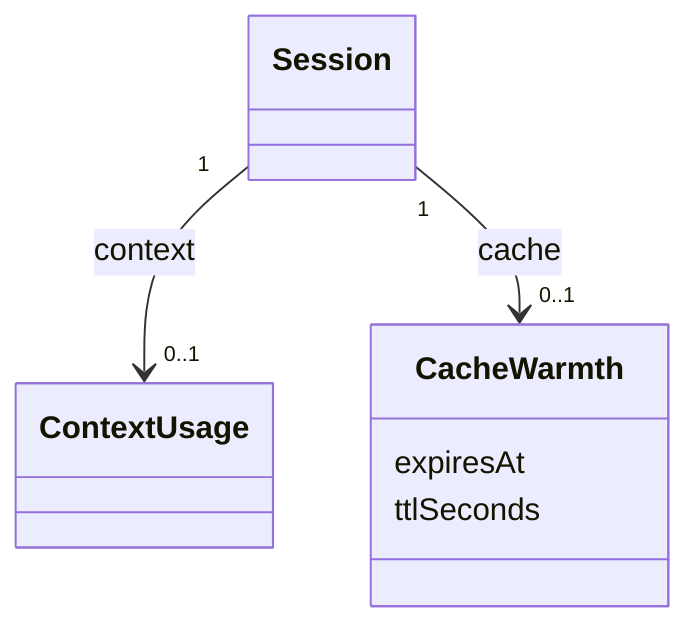

# Plan: Rail card menu, drag into groups, and cache warmth

**Created**: 2026-10-14
**Status**: completed
**Work Type**: full-stack
**E2E Scope**: new-specs
**Fixture plan**: rail-menu.spec.ts daemon (asserts groupId/pin changes and the daemon-down state, which kills the daemon); rail-drag-groups.spec.ts daemon (asserts rail order and group membership); cache-warmth.spec.ts daemon (restarts the daemon for the restart criterion)
**Features**: rail, groups, actions, usage, canary
**Touches**: lifecycle, ingest, tiles, connection, focus, surfaces
**Description**: Right-click menu on rail and strip cards (#56), drag into groups in both sort orders with selection drag (#77), and prompt-cache warmth on card and group-header timers (#84), plus the canary guard for `prompt_cache`.

## Overview

Three rail changes from the approved spec (`plans/rail-card-organise/spec.md`), planned as
one run because they all reshape the rail card.

**#56 — right-click menu.** A rail or strip card's Stop, Resume and Remove move into a
right-click menu (also opened by the context-menu key and Shift+F10), with Move to and
Pin/Unpin. The ended card's hover action row goes; the card's pin control stays (the
developer's call at planning: it is a control on the card, not an action row). No protocol
change: the menu calls the endpoints the Focus header, the selection bar and Move to already
call.

**#77 — drag into groups.** Cards drag in both sort orders. In attention order a drop changes
only the group (through `kb:anchor/sessions.group`); in manual order it also sets position and
pin (through `kb:anchor/sessions.order` with `groupId`, as today). In Select mode a selected
card drags the whole selection; an unselected card does not drag; a click still toggles.

**#84 — cache warmth.** The status line's `prompt_cache` gives each session's cache expiry and
lifetime. The daemon adopts them onto the Session (new `cache` field, persisted), keeps them
across Stop, a daemon restart and Resume, and clears them only at `/clear`. The dashboard
reads `expiresAt` against its own clock, so warmth keeps changing while a session posts
nothing. One rule (the developer's call at planning, superseding the spec's "working and
started look as today"): **wherever warmth is known — any state, ended included — the card
timer is tinted**; a session with no warmth yet (started, never replied, or just after
`/clear`) shows today's plain timer. Two probes on 2026-10-14 shaped this: a resume inside the
TTL reads the earlier cache (kb:fact/resume-reads-prior-prompt-cache), and the main thread's
TTL is not always an hour (kb:fact/haiku-main-cache-ttl-5m-on-2-1-299). The re-send token
count is not shown (the developer: context is already on the card), so it is not on the wire.

## Requirements

### Must Have

**Right-click menu (#56)**
- [ ] REQ-1: Right-clicking a rail card or a Tiles strip card opens a menu of that session's actions and suppresses the browser's own menu.
- [ ] REQ-2: A live session's menu offers `Stop…`; an ended session's offers `Resume…` and `Remove…`; every session's menu then offers a `Move to` section (each group in rail order, `New group…`, `No group`) and `Pin` or `Unpin`.
- [ ] REQ-3: `Resume…` is absent (not disabled) when the session has no Claude session id to resume.
- [ ] REQ-4: `Stop…`, `Resume…` and `Remove…` open the same confirm dialogs the Focus header opens; confirming acts, cancelling sends nothing.
- [ ] REQ-5: `Move to` → a group, `New group…` or `No group` changes the session's group exactly as the Focus header's group control does; `Pin`/`Unpin` acts as the card's pin control does.
- [ ] REQ-6: No rail or strip card renders a Stop, Resume or Remove button, on hover, on focus, live or ended (the `.acts-row` goes from the card). The pin control stays.
- [ ] REQ-7: Right-clicking a card in Select mode opens the same single-session menu; the selection is unchanged.
- [ ] REQ-8: The menu closes on Escape (focus back to the card), a click outside it, or a choice; right-clicking another card while one is open replaces it.
- [ ] REQ-9: With keyboard focus on a card, the ContextMenu key or Shift+F10 opens its menu with the first item focused.
- [ ] REQ-10: While the daemon is down every menu item is disabled.
- [ ] REQ-11: A session removed while its menu is open closes the menu.

**Drag into groups (#77)**
- [ ] REQ-12: In both sort orders, a card dropped on a group's header or among its cards joins that group; one dropped on Ungrouped's header or among its cards leaves its group.
- [ ] REQ-13: In attention order the drop changes only the group (pin flag kept, `kb:anchor/sessions.group`); the card then sits where attention order places it. A drop inside the card's own section in attention order changes nothing and sends nothing.
- [ ] REQ-14: In manual order the drop also sets position and pin, as today (`kb:anchor/sessions.order` with `groupId`). *Amended (review cycle 1, correctness Major 4; measured by the browser review): "as today" means a drop among a section's cards goes through `kb:anchor/sessions.order` with `groupId`, and a drop on a header goes through `kb:anchor/sessions.group` (kb:adr/rail-cards-drag-in-both-sort-modes-selection-together).*
- [ ] REQ-15: In Select mode a press released without moving toggles selection, as today; dragging a selected card carries every selected session; an unselected card is not draggable.
- [ ] REQ-16: A selection dropped on one section moves all of it there (ended sessions included); in manual order the selected cards land contiguously at the drop position in their current display order.
- [ ] REQ-17: Outside Select mode a drag carries only the dragged card.
- [ ] REQ-18: A drag released where it started, outside the rail, or on a section the filter hides changes nothing: no request, selection unchanged.
- [ ] REQ-19: Section headers keep dragging to reorder sections in both sort orders.
- [ ] REQ-20: A drop the daemon rejects (the group was deleted meanwhile) leaves the cards where they were and shows the error in the action-error line.

**Cache warmth (#84)**
- [ ] REQ-21: The daemon adopts `prompt_cache.expires_at` and `prompt_cache.ttl` from a routed status post onto the session's `cache`; a post without a usable `prompt_cache` leaves the last-known value untouched.
- [ ] REQ-22: `cache` is null at launch, is cleared by a `/clear` rebind, and is kept by Stop, liveness death, Resume, a compaction and a daemon restart.
- [ ] REQ-23: A change in `cache` is broadcast as a `sessionUpsert`; an unchanged one is not.
- [ ] REQ-24: On rail and strip cards, a session whose `cache` is non-null has its timer tinted, in every state including ended: a straight-line fade from the bright foreground to the timer's usual grey over `ttlSeconds`, plain grey once `expiresAt` has passed.
- [ ] REQ-25: While the remaining time is above zero and at most 15% of `ttlSeconds`, the timer also carries a dotted underline.
- [ ] REQ-26: A session whose `cache` is null shows today's plain timer.
- [ ] REQ-27: Hovering a card timer shows one line: `cache warm · cold in <n>m` (whole minutes rounded up while ≥ 60 s remain, else `cold in <n>s`), `cache cold`, or `cache unknown`.
- [ ] REQ-28: Warmth keeps fading on the 1 s render tick with no messages arriving, and while the daemon is down (from the last-known `expiresAt`).
- [ ] REQ-29: A group header whose section has an alive member in `idle`, `needs_input` or `failed` shows one extra timer after its state dots: that set's member with the latest `stateSince`, its state timer tinted and underlined as on its card. A section with none shows no extra timer, collapsed or expanded.
- [ ] REQ-30: The header timer's hover counts that set's members with known warmth: `<w> of <k> warm · next cold in <t>` (t = the soonest expiry among the warm ones, same format as REQ-27) when any is warm, `all <k> cold` when none is, `cache unknown` when k is 0.
- [ ] REQ-31: The header popover shows every listed session's state timer beside its title, tinted and underlined where its warmth is known.
- [ ] REQ-32: Warmth renders correctly after a daemon restart and after a dashboard reload.

**Canary**
- [ ] REQ-33: The canary's harness tier asserts, after the first turn, that a status post carries `prompt_cache` whose `ttl` Muster's interpreter accepts and whose `expires_at` is the turn's `Stop` time plus that TTL within 15 s.

## Protocol Contract

Delta against `docs/protocol.md`.

### WS daemon→UI: the Session object (`kb:anchor/ws.session`) gains `cache`

Added beside `context`:

```jsonc
"cache": { "expiresAt": "2026-10-14T16:43:26Z",   // ISO8601 UTC — status line prompt_cache.expires_at (Unix seconds) converted
           "ttlSeconds": 3600 },                   // integer > 0 — prompt_cache.ttl parsed ("5m" → 300, "1h" → 3600)
                                                   // required key; object | null. null = unknown: before the session's first
                                                   //   usable prompt_cache, and after a /clear rebind until the next one.
```

Value semantics, added to the list under the object:

- `cache`: adopted from a routed status post whose `prompt_cache` carries an integer
  `expires_at` and a `ttl` of the form `<digits><s|m|h>` with a value > 0; both fields replace
  together. A post without `prompt_cache`, or with either field missing or unparseable,
  changes nothing (absent means unknown for that post, never cold —
  kb:fact/prompt-cache-status-shape). Kept by Stop, liveness death, Resume, compaction and a
  daemon restart (it lives on the session row): a resume inside the TTL reads the earlier
  cache (kb:fact/resume-reads-prior-prompt-cache). Cleared to null by a `/clear` rebind.
  Display-only — never read by the state machine. The daemon never compares it with the
  clock; the client does.

Delivered by the existing `sessionUpsert` (whole object) and in `snapshot.sessions`; a change
in `cache` alone is a broadcast, an unchanged value is not.

### HTTP: `PUT /api/sessions/order` (`kb:anchor/sessions.order`) — wording only

"With `groupId` the listed ids are expected to be one section's cards plus the dragged one"
becomes "…one section's cards plus the dragged ones (a selection drag lists several)". The
request, response and errors are unchanged.

No other endpoint or message changes: the menu uses `kb:anchor/sessions.end`,
`kb:anchor/sessions.resume`, `kb:anchor/sessions.remove`, `kb:anchor/sessions.pin`,
`kb:anchor/sessions.group` and `kb:anchor/groups.create`; attention-order drops use
`kb:anchor/sessions.group`.

## Schema Changes

Migration `0014_prompt_cache.sql`, forward-only:

```sql
ALTER TABLE session ADD COLUMN cache_expires_at TEXT;       -- RFC3339 UTC; NULL = unknown
ALTER TABLE session ADD COLUMN cache_ttl_seconds INTEGER;   -- NULL iff cache_expires_at is NULL
```

Existing rows read `cache: null`. The two columns are written together.

## Diagrams

`delta of kb:diagram/domain-model` — the Session gains its cache warmth beside Context Usage:



The orchestrator applies this to the record's existing diagram (add the `CacheWarmth` box and
its edge; nothing else changes).

## UI Specifications

Governing: `docs/design/design-system.md` §3 (state colour is meaning — warmth uses the
foreground-to-grey ramp, never a state colour), §5 Components (Menu, rail card), §6 Honesty
rules (unknown is shown as unknown, never as cold); `docs/design/ux-flows.md` "Rail card";
mockup `plans/cache-warmth/mockups/timer-tint.html`, the **Recommended** row, minus its
re-send token count.

### Views
- **Rail card and Tiles strip card** — no `.acts-row`; right-click / ContextMenu / Shift+F10
  opens the card menu; the `.timer` carries warmth.
- **Card menu** — the one menu builder (kb:adr/web-menu-component-single-builder), opened at
  the pointer for a right-click and at the card for the keyboard. Items in order: `Stop…`
  (live) or `Resume…` (ended, only when resumable) then `Remove…` (ended), a separator, the
  `Move to` header with each group by name (ticked when current), `New group…`, a separator,
  `No group` (ticked when ungrouped), a separator, `Pin` or `Unpin`.
- **Group header summary** — after the state dots, the extra timer of REQ-29.
- **Group header popover** — each session row gains its state timer (REQ-31).

### Timer warmth (REQ-24–28)
`remaining = expiresAt − now`, `f = clamp(remaining / ttlSeconds, 0, 1)`. The timer's colour
is the bright foreground mixed with the timer's normal colour at `f` (f = 1 → foreground, f = 0
→ today's timer colour), so the light theme fades dark-to-grey rather than drawing white on
white. States exposed on the timer as `data-cache`:

| `data-cache` | when | look | hover (`title`) |
|---|---|---|---|
| `warm` | remaining > 15% of ttl | tinted at f | `cache warm · cold in <n>m` |
| `cooling` | 0 < remaining ≤ 15% of ttl | tinted at f + dotted underline | `cache warm · cold in <n>m` / `<n>s` |
| `cold` | remaining ≤ 0 | today's timer colour | `cache cold` |
| `unknown` | `cache` null | today's timer colour | `cache unknown` |

The group header timer carries the same `data-cache` and look; its `title` is REQ-30's text.
Popover timers carry `data-cache` and the look, no `title`.

### User Flows
1. Right-click a live card → menu → `Stop…` → the Stop confirm → Stop → the card greys out.
2. Right-click an ended card → `Move to` → `review` → the card moves to the `review` section.
3. Attention order: drag a card onto the `review` header → it joins `review` at the place
   attention order gives it.
4. Select mode: tick two cards, drag one onto the Ungrouped header → both leave their groups;
   select mode and the selection stay.
5. A session goes idle: its timer is bright and greys over the TTL; in the last 15% it is
   underlined; the hover tells how long until cold.

### States
- **No data yet:** `cache` null → plain timer, `data-cache="unknown"`, hover `cache unknown`.
  A group with no idle, needs-input or failed alive member shows no extra timer.
- **Data:** as the table above.
- **Daemon down:** the timers keep fading from the last-known `expiresAt`; the menu opens with
  every item disabled; drag drops send nothing (the existing disconnected behaviour of the
  rail's controls).

### Testable UI Elements

| Element | Role | Name / Text Pattern | Notes |
|---------|------|---------------------|-------|
| Card menu | `menu` | — | built by the one menu builder (`role="menu"`); one open at a time |
| Stop item | `menuitem` | `Stop…` | live sessions only |
| Resume item | `menuitem` | `Resume…` | ended and resumable only |
| Remove item | `menuitem` | `Remove…` | ended sessions only |
| Move to group item | `menuitem` | `<group name>` | under the `Move to` header; `aria-current="true"` on the current group |
| New group item | `menuitem` | `New group…` | opens the existing New group dialog with this session |
| No group item | `menuitem` | `No group` | `aria-current="true"` when ungrouped |
| Pin item | `menuitem` | `Pin` / `Unpin` | by `pinned` |
| Card timer | — | `mm:ss` / `<n>h` / `<n>d` / `ended <age>` as today | `.timer` keeps `aria-label="time in state"`; gains `data-cache` and `title` per the table |
| Group header timer | — | the member's timer text | inside the header summary; `data-cache`, `title` per REQ-30; absent when REQ-29 picks no one |
| Popover row timer | — | the member's timer text | one per session row in the header popover; `data-cache` |
| Rail card | `—` | as today | `draggable="true"` in both sort orders outside Select mode; in Select mode `"true"` iff selected |

### Invariants
- **INV-1** — `cache` is non-null ⇒ both `expiresAt` and `ttlSeconds` are set and `ttlSeconds > 0`; never half.
- **INV-2** — the timer's `data-cache` is `unknown` iff the session's `cache` is null, on every rail and strip card, in every state (started, planning, working, needs_input, failed, idle, ended).
- **INV-3** — no rail or strip card contains a Stop, Resume or Remove button, in any state, hovered, focused, current or not, in either view.
- **INV-4** — a menu action, a drag drop or a selection drag changes only the sessions it names: other sessions' `groupId`, `pinned` and selection are untouched (bystanders asserted in E-criteria with three or more sessions present).
- **INV-5** — `cache` is cleared only by a `/clear` rebind: every other transition, Stop, death, Resume, compaction and restart leaves it as it was.

Invariant walk: INV-5 is crossed against every `applyInput` kind in `internal/session/machine.go`
(D6); INV-2 against every state and the ended flag (W3); INV-3 in both views and both states
(E3, E4).

### Carried-over measurements
- kb:fact/prompt-cache-status-shape measured `ttl: "1h"` on 2.1.259–2.1.296. Re-checked
  against kb:fact/haiku-main-cache-ttl-5m-on-2-1-299: no longer a constant, so nothing in this
  plan assumes an hour — the fade, the underline and the canary all read `ttlSeconds`.
- "Absent means unknown" (kb:fact/prompt-cache-status-shape) re-checked against Resume:
  absent between the resume and its first reply (kb:fact/resume-reads-prior-prompt-cache), so
  keeping the last-known value there is correct, not stale.

## Affected Files

### Daemon (daemon-impl)
- `internal/claudecode/status.go` — REQ-21: interpret `prompt_cache` (`expires_at` seconds → time, `ttl` string → seconds) into the neutral status update; absent or unparseable → nothing.
- `internal/claudecode/claudecodetest/claudecodetest.go` — REQ-21: status-line bodies can carry a `prompt_cache` for other packages' tests.
- `internal/session/status.go` — REQ-21, REQ-23: adopt the cache on change only.
- `internal/session/session.go` — REQ-21: the session carries its cache.
- `internal/session/machine.go` — REQ-22: `/clear` rebind clears it; no other path touches it.
- `internal/session/row.go` — REQ-22, REQ-32: cache to and from the row.
- `internal/store/session.go` — REQ-22, REQ-32: read and write the two columns.
- new `internal/store/migrations/0014_prompt_cache.sql` — Schema Changes.
- `internal/server/sessionwire.go` — the `cache` wire field.

### Web (web-impl)
- `web/index.html` — REQ-6: `.acts-row` leaves `session-card-template`.
- `web/src/sessions/card.ts` — REQ-2, REQ-3, REQ-6, REQ-24–27: card view-model loses its actions; gains the timer's warmth (state, fraction, hover text); the menu's entries are derived DOM-free.
- `web/src/render/sessions.ts` — REQ-6, REQ-24–26: no action row; timer `data-cache`, `title`, tint and underline.
- `web/src/render/menu.ts` — REQ-1, REQ-9: opening at a point as well as under an opener.
- `web/src/features/rail.ts` — REQ-1, REQ-7–11, REQ-12–18: card context menu; card drag in both orders and with the selection.
- `web/src/render/dragreorder.ts` — REQ-15–18: a drag that carries several ids; a drop the caller refuses does nothing.
- `web/src/features/tiles.ts` — REQ-1, REQ-6: the strip card's menu; no strip action row.
- `web/src/features/groups.ts`, `web/src/features/groupsselect.ts` — REQ-5, REQ-12–16: Move to reused by the card menu; select mode keeps cards draggable when selected.
- `web/src/sessions/sections.ts`, `web/src/sessions/railorder.ts` — REQ-13, REQ-14, REQ-16: drop math for attention (group only) and for a multi-id manual drop.
- `web/src/render/railsections.ts` — REQ-29, REQ-30: header warmth timer.
- `web/src/render/grouppopover.ts` — REQ-31: popover row timers.
- `web/src/protocol/session.ts` — the `cache` field decoded (null-safe).
- `web/src/style.css` — REQ-24, REQ-25: the tint ramp and the dotted underline; `.acts-row` card rules go.
- new under `web/src/sessions/cache*.ts` — REQ-24–30: pure warmth derivation (state, fraction, hover text, group pick and count).

### Tests (daemon-tests)
- `test/canary/harness_test.go` (or a sibling in `test/canary/`) — REQ-33.

### Existing tests this breaks
- daemon-tests: `internal/store/migrate_test.go:39,43` — migration count and max version 13 → 14.
- daemon-tests: `internal/server/sessionwire_test.go:216` — the Session object's key list gains `cache`.
- web-tests: `web/src/sessions/card.test.ts:587,595` — the view-model's `actions` (ended → Resume, Remove) goes.
- web-tests: `web/src/render/sessions.test.ts:245,307,769` — the card fixture's `.acts-row`.
- e2e-specs: `web/e2e/rail-cards.spec.ts:268,314,700` — an ended card's Remove/Resume buttons and its action row.
- e2e-specs: `web/e2e/rail-order.spec.ts:387` — "rail cards are draggable only in Manual mode".
- e2e-specs: `web/e2e/groups.spec.ts:1165` — "cards are not draggable in attention sort".
- e2e-specs: `web/e2e/groups-select.spec.ts:100` — select-mode cards are `draggable="false"`.

## Edge Cases

1. `/clear` mid-session: the `KindClearRebind` clears `cache`; the next status post of the new conversation refills it → D5.
2. `/clear`'s `SessionStart` arrives after the new conversation's first status post carrying `prompt_cache`: the rebind clears the freshly adopted value; the next post re-adopts it (posts repeat every tool use and after each Stop) → D5.
3. A straggler status post from the old conversation (old `session_id`) arrives after the `/clear` rebind: status posts never rebind and are routed by envelope; one carrying the old `prompt_cache` would re-adopt an old expiry → untested: status posts carry no conversation marker the daemon routes on, and the old cache's expiry is a true bound for at most one post until the next corrects it.
4. A status post without `prompt_cache` after one with it (seen in 2 sessions): value kept → D2.
5. `ttl` is a value never seen (`"30m"`, `"2h"`) → parsed by the same rule; `"x"` or `"0m"` → not adopted → D1.
6. Resume: `cache` kept; between the resume and its first reply no `prompt_cache` arrives, so the card shows the previous expiry → D6.
7. Stop / pane death: `cache` kept; the ended card's `ended <age>` timer is tinted → D6, W3.
8. Daemon restart: `cache` read back from the row → D7, E15.
9. Dashboard reload: snapshot carries `cache` → E15.
10. Daemon down: timers keep fading; menu items disabled → E6, E14.
11. 5-minute TTL: fades over 300 s and underlines for the last 45 s → W2.
12. Client clock ahead of or behind the daemon by seconds: the fade is off by that much; `expiresAt` is an absolute time from Claude Code's own clock on the same machine → untested: same-host clocks.
13. Right-click while another menu (header ⋯, Move to, rail ⋯) is open: that menu closes and the card menu opens → E7.
14. An action already running on the session (a Stop in flight): the menu's items for it are disabled, as the Focus header's are → W5.
15. The session is removed (another window) while its menu is open: the menu closes → E8.
16. Selection across groups dropped on one section: all move there; in attention order through one `PUT /api/sessions/group` → E11.
17. Selection containing ended sessions: they move like the rest → E11.
18. Attention-order drop of a pinned card into another group: it keeps its pin and sits in the new section's pinned block → E10.
19. Drop on a section the filter hides: impossible to target (hidden); a drop elsewhere outside a section does nothing → E12.
20. Drop rejected with `404 unknown_group` (group deleted in another window): the error shows in the action-error line, nothing moves → E13.
21. Group with every waiting member's warmth unknown: header timer plain, hover `cache unknown` → W4.
22. Group whose only members are working or ended: no header timer → W4.
23. Select mode: a press without movement on an unselected card selects it; it can then be dragged → E11.
24. Drag of the only selected card onto its own section in attention order: nothing sent → E12.

## Acceptance Criteria

### Daemon
- **D1**: `InterpretStatus` adopts `prompt_cache` with an integer `expires_at` and a `ttl` of `<digits><s|m|h>` (> 0) and rejects a missing, non-integer, zero or malformed one, table-tested.
- **D2**: a status post without `prompt_cache` leaves a session's `cache` unchanged and broadcasts nothing for it.
- **D3**: a status post whose cache equals the session's broadcasts no `sessionUpsert`.
- **D4**: a status post with a changed cache broadcasts exactly one `sessionUpsert` carrying it.
- **D5**: a `/clear` rebind sets `cache` to null from every source state.
- **D6**: INV-5 — every other `applyInput` kind, Stop, liveness death and Resume leave `cache` unchanged, from every source state.
- **D7**: `cache` round-trips through the store and survives a manager restart.
- **D8**: the wire Session object always carries the `cache` key: null, or `{expiresAt, ttlSeconds}` with `expiresAt` RFC3339 UTC.

### Web
- **W1**: the warmth derivation returns `warm`/`cooling`/`cold`/`unknown`, the fraction and the hover text for a table of remaining times against 3600 s and 300 s TTLs, boundaries included (exactly 15%, exactly 0, 59 s, 60 s, 61 s).
- **W2**: with a 300 s TTL the underline starts at 45 s remaining.
- **W3**: INV-2 — the card view-model's warmth is `unknown` iff `cache` is null, for every state with alive true and false.
- **W4**: the group pick chooses the alive idle/needs_input/failed member with the latest `stateSince`, ignores working, started, planning and ended members, and the hover counts only known-warmth members (REQ-30's three texts).
- **W5**: the card menu's entries are derived per REQ-2/REQ-3 for live, ended-resumable and ended-unresumable sessions, with every item disabled while disconnected or while an action on that session is in flight.
- **W6**: the attention-order drop computes a group-only move, the manual-order multi-id drop computes one `PUT /api/sessions/order` body with the selection contiguous at the drop position, and a drop into the card's own section in attention order computes nothing.

### E2E
- **E1**: right-clicking a live rail card opens a menu with `Stop…`, the group items, `New group…`, `No group` and `Pin`, and no `Resume…`/`Remove…`.
- **E2**: right-clicking an ended resumable rail card opens a menu with `Resume…`, `Remove…`, the Move to items and `Pin`/`Unpin`, and no `Stop…`.
- **E3**: INV-3 — no rail card, live or ended, hovered or focused, contains a button named Stop, Resume or Remove.
- **E4**: the same menu opens on a Tiles strip card, and no strip card contains a Stop, Resume or Remove button.
- **E5**: `Stop…` from the menu opens the Stop confirm; cancelling leaves the session alive; confirming ends it.
- **E6**: with the daemon killed, the card menu opens with every item disabled.
- **E7**: Escape closes the card menu and returns focus to the card; right-clicking a second card replaces the first menu.
- **E8**: removing the session from another page while its menu is open closes the menu.
- **E9**: Shift+F10 on a focused card opens its menu; `Move to` → a group moves it there and `No group` moves it back, with a third session's group untouched.
- **E10**: in attention order, dragging a pinned card onto another group's header puts it in that group, pinned, and a bystander's group and pin are unchanged.
- **E11**: in Select mode, a click on an unselected card selects it; dragging one of two selected cards (one ended, from different groups) onto a group's header moves both there; select mode and the selection remain.
- **E12**: an unselected card in Select mode has `draggable="false"`; a drag released on its own card, or in attention order inside its own section, sends no request and changes nothing.
- **E13**: dropping onto a group deleted meanwhile shows the error in the action-error line and moves nothing.
- **E14**: an idle session posted with `expires_at` = now + 3600 s and `ttl` `"1h"` shows `data-cache="warm"` and a hover `cache warm · cold in 60m`; with the page clock advanced 52 min and no new posts it shows `cooling`; advanced past expiry it shows `cold` and `cache cold`.
- **E15**: a session's warmth is the same after a daemon restart and a page reload.
- **E16**: a started session with no `prompt_cache` shows `data-cache="unknown"` and `cache unknown`; after `/clear` a warm session returns to `unknown`.
- **E17**: a working session with a known cache shows a tinted timer (`data-cache="warm"`).
- **E18**: a group header shows the extra timer for its most recently entered idle member with `<w> of <k> warm · next cold in <t>`; a group with only working members shows none.
- **E19**: the header popover shows a timer per session row with `data-cache`.
- **E20**: section headers still reorder sections by drag in both sort orders (existing spec, kept green).

### Automated Checks

```checks
D1 make test
D2 make lint
D3 go build ./...
D9 ! rg -n '"(prompt_cache|expires_at)"' cmd/ internal/ --glob '!internal/claudecode/**'
W1 make web-test
W2 make web-build
E1 make e2e
K1 make check-kb
```

D9 (the cache keys stay inside the adapter boundary) scope: `_test.go` files in `internal/server/` and `internal/session/` are in the net; they
build bodies through `claudecodetest` (Affected Files), so they need no literal. `test/canary/`
is outside the grep's paths and legitimately reads the raw key.

### Reviewer-Verified
- **W7**: no `any` in new web code.
- **W8**: the tint uses tokens from `:root` (no hard-coded white) and reads correctly in the Light theme (dark foreground fading to grey).
- **W9**: no state colour is used for warmth (design-system §3).
- **W10**: the card menu is built by `render/menu.ts`, not a second builder.
- **D10**: REQ-33's canary assertion reads `ttl` through Muster's interpreter rather than assuming an hour.

## Doc Delta

**rail** — becomes true:
- A dead card greys out. No card renders a Stop, Resume or Remove button; a right-click, the context-menu key or Shift+F10 opens the session's menu: Stop, or Resume and Remove, then Move to and Pin or Unpin (kb:spec/actions).
- Where cache warmth is known, the timer fades from the foreground to grey over the cache's lifetime, is underlined in its last 15% and names the warmth on hover (kb:spec/usage).
- Cards drag in both sort modes (kb:spec/groups).

**rail** — stops being true:
- "A live card offers no action button (kb:adr/rail-live-card-offers-no-actions); a dead card greys out and offers Resume and Remove in its hover-revealed action row (kb:spec/actions)."

**groups** — becomes true:
- In either sort mode a card dropped on a header or among a section's cards joins that group, and one dropped among Ungrouped's cards leaves its group; in attention mode the drop changes only the group. Move to does the same.
- While Select mode is on, a click toggles a card instead of focusing it; dragging a selected card carries the whole selection, an unselected card does not drag, and a drag released where it started changes nothing.
- After the dots, the summary shows the timer of the last member to start waiting on the developer, tinted by cache warmth, its hover counting the warm ones; the popover tints each session's timer.

**groups** — stops being true:
- "In manual mode a card dropped on a header or among a section's cards joins that group; Move to does the same in either mode."
- "Cards are not draggable while it is on, and a click toggles a card instead of focusing it (kb:adr/rail-select-mode-disables-card-drag)."

**actions** — becomes true:
- They live in the Focus mainhead above the terminal, in tile footers, and in the right-click menu of rail and strip cards; no card renders an action button.

**actions** — stops being true:
- "They live in the Focus mainhead above the terminal, in tile footers, and in hover-revealed action rows on ended rail and strip cards; a live rail or strip card offers no action button (kb:adr/rail-live-card-offers-no-actions)."

**usage** — becomes true:
- Each session also carries its prompt-cache warmth from the status line's `prompt_cache` (kb:fact/prompt-cache-status-shape): when it expires and its lifetime, which varies (kb:fact/haiku-main-cache-ttl-5m-on-2-1-299). It is unknown before the session's first reply and after `/clear`, and survives Stop, Resume and a daemon restart, since a resume inside the lifetime reads the same cache (kb:fact/resume-reads-prior-prompt-cache). The dashboard reads the expiry against its own clock, so warmth keeps changing while a session sends nothing.

**usage** — stops being true:
- nothing

**canary** — becomes true:
- After the first turn, the harness tier asserts that the status line's `prompt_cache` carries a `ttl` Muster can read and an `expires_at` of the turn's end plus that TTL (kb:fact/prompt-cache-status-shape).

**canary** — stops being true:
- nothing

**protocol** — `docs/protocol.md` gains the Protocol Contract above at approval (the Session object's `cache`, the order endpoint's wording).

## Out of scope

- Tiles grid tiles and the Focus header's timer: no warmth, no menu.
- Drag in the Tiles strip.
- Rename in the card menu.
- Subagent cache warmth (kb:fact/subagent-cache-ttl-5m).
- Notifications near expiry.
- The re-send token count (`recache_tokens_if_cold`): not shown, not on the wire.
- A canary guard for the resume-reads-cache fact (it needs a token-burning turn after the resume).

## Implementation Notes

**Hints (non-binding):**
- Native HTML5 drag already waits for a few pixels of movement before `dragstart`, and a press released without movement fires `click`, so REQ-15's click-or-drag threshold needs no code of its own.
- `features/groups.ts` `openMoveMenuFor` already builds Move to's entries from a session list; the card menu can reuse it rather than build a second copy.
- `render/menu.ts` names its panel from the first header entry, so a card menu would be named `Move to` — give the menu its own name or none.
- The 1 s render tick (`render/sessions.ts`) already rewrites the timer text; warmth can ride the same pass.
- `/clear`'s reset sits beside `sess.Context = nil` in `internal/session/machine.go` (the `KindClearRebind` block).
- `expires_at` also moves by a second or two after side requests (title generation) with `requests` unchanged (capture-3-state-2026-10-12); each such move is one more upsert, harmless.

**Decisions** (ADRs written at approval, `proposed`):
- kb:adr/rail-card-right-click-menu-holds-session-actions — supersedes kb:adr/rail-live-card-offers-no-actions.
- kb:adr/rail-cards-drag-in-both-sort-modes-selection-together — supersedes kb:adr/rail-select-mode-disables-card-drag and kb:adr/rail-section-headers-drag-in-both-sort-modes (restating its header clause).
- kb:adr/usage-cache-warmth-kept-until-clear-read-against-client-clock — the wire carries expiry and lifetime only; cleared only by `/clear`.
- kb:adr/rail-timer-tinted-wherever-cache-warmth-known — the fade, underline, hover and header timer; one rule across states.

**Doc upkeep (orchestrator):** apply the domain-model diagram delta; set `guard:` on
kb:fact/prompt-cache-status-shape to REQ-33's canary test; the two 2026-10-14 facts ride this
plan's commit.

**Facts handled:** kb:fact/prompt-cache-status-shape, kb:fact/haiku-main-cache-ttl-5m-on-2-1-299,
kb:fact/resume-reads-prior-prompt-cache, kb:fact/refresh-interval-seconds,
kb:fact/unknown-before-first-response, kb:fact/clear-mints-new-session-id.
