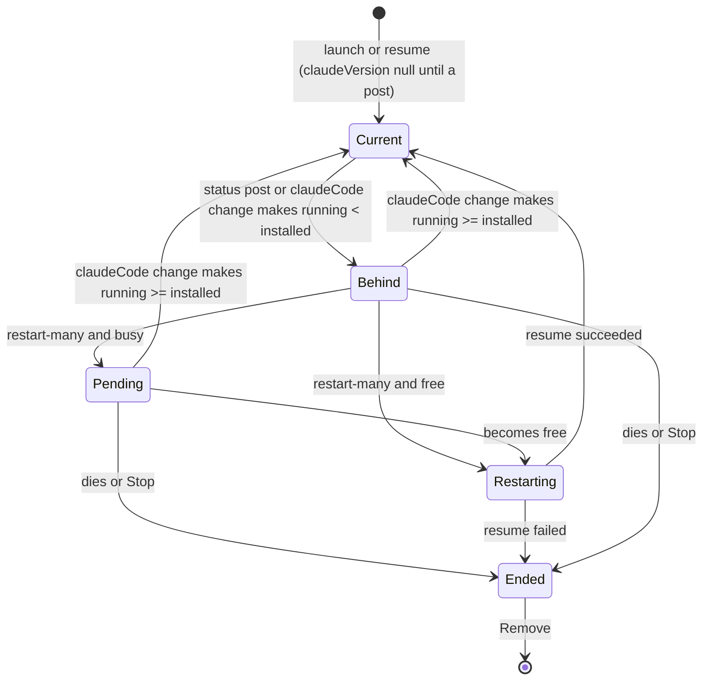

# Plan: Restart Latest Claude

**Created**: 2026-11-04
**Status**: completed
**Work Type**: full-stack
**E2E Scope**: new-specs
**Fixture plan**: claude-restart.spec.ts daemon (the notice counts every live session's version, daemon-global state; one journey restarts the daemon)
**Render fixtures**: new: claude-restart (installed 2.1.318; seven alive sessions — idle 2.1.317, failed 2.1.316, working 2.1.317, idle with 2 background tasks 2.1.317, needs input 2.1.317, planning 2.1.317 with a restart already pending, idle 2.1.318 — plus one ended session), new: claude-restart-queued (installed 2.1.318; two alive sessions on 2.1.317, both with a restart pending, none unconfirmed), new: claude-restart-down (claude-restart's state with the daemon down), new: claude-restart-many (installed 2.1.318; fourteen alive sessions on 2.1.317, seven idle and seven working — edge case 29 / R3)
**Features**: connection, actions, lifecycle, ingest
**Touches**: usage, canary, launch, focus, rail, tiles, issue, settings, surfaces, theme, update
**Description**: Detect live sessions running an older Claude Code than the installed one and restart them all onto it from the masthead's version readout, queueing busy ones until they are free.

## Overview

Claude Code's auto-updater installs a new version under `~/.local/share/claude/versions/` and
repoints the `claude` symlink; every session already running keeps executing the binary it
started from until it is relaunched (kb:fact/running-session-version-sources). Muster already
watches the installed version and pushes it to the dashboard (kb:adr/connection-claude-version-watched-and-pushed).
This plan adds the other half: each session's **running** version, read from the status line's
`version` field (posted before the first prompt), stored on the session row, and compared with
the installed version to mark the session **behind**.

When any live session is behind, the masthead's Claude version readout becomes a button
(`claude 2.1.316→318` with a neutral dot). It opens a small panel with two counts — sessions
that can restart now and sessions that will restart when free — and **Ignore** / **Restart…**.
Restart… opens a confirm dialog listing both groups in collapsible sections. Confirming sends
one daemon batch: every *free* session (idle with no background tasks, or failed) is stopped
and resumed in place at once — same row, title, group, rail position, conversation, latched
permission mode and effort — and every busy one is **queued**: the daemon restarts it the
moment it next becomes free. Stopped sessions are never touched; they pick up the new version
on their next Resume. Ignore lasts for the browser tab (session storage), per installed version.

There is no per-session or per-group restart, and no queue cancel (the developer, 2026-11-04).
Mockups: `plans/restart-latest-claude/mockups/option-b-many.html` (B1 is the chosen design) and
`dialog.html` (the dialog's content; B1's collapsible sections supersede its static lists).

## Requirements

Terms used throughout:
- **running version** — the session's `claudeVersion.running` (§ Protocol Contract).
- **behind** — the session is alive, its running version and the installed version
  (`claudeCode.installed`) are both known, and running < installed by semver.
- **free** — `state == "idle"` with `backgroundTasks == 0`, or `state == "failed"`.
- **restart** — the Stop path (`kb:anchor/sessions.end`) followed by the Resume path
  (`kb:anchor/sessions.resume`) on the same row, under the session's lock.

### Must Have
- [ ] REQ-1: A routed status post carrying a parseable `version` sets the session's running version; a post without one, or with an unparseable one, changes nothing.
- [ ] REQ-2: The running version is cleared to null by launch, resume (including a restart) and every death; it is kept by `/clear` and by a daemon restart while the session stays alive.
- [ ] REQ-3: Each Session carries `behind`, recomputed whenever the running or the installed version changes; a change of the installed version broadcasts an upsert for exactly the sessions whose `behind` flipped.
- [ ] REQ-4: `POST /api/sessions/restart` restarts each listed free, behind session at once and marks each listed busy, behind session restart-pending, reporting `done`, `queued`, `skipped` and `failed`.
- [ ] REQ-5: A restart-pending session is restarted, once, the moment it becomes free; the pending mark is cleared by that restart (whatever its outcome), by the session dying, by Remove and by the session no longer being behind.
- [ ] REQ-6: The pending mark is persisted; after a daemon restart a reloaded mark stays off the wire (`restartPending: false`, `behind: false`) and unfired until the first installed-version result, which re-derives it — a pending session still behind and already free is restarted then, and a mark no longer behind (or installed unknown) is cleared. *Amended 2026-11-04 by user decision (review cycle 1, code Decision 1; plans/restart-latest-claude/decisions/pending-marks-held-until-installed-known/decision.md, kb:adr/restart-pending-marks-held-until-installed-known).*
- [ ] REQ-7 (journey): With at least one behind session, the masthead readout is a button showing the oldest behind version and the installed one; its panel shows the two counts with Ignore and Restart….
- [ ] REQ-8 (journey): Restart… opens a confirm dialog listing the behind, not-yet-pending sessions in two collapsible sections, Restart now and Restart when free, each row with its reason; confirming posts their ids and the free ones come back resumed.
- [ ] REQ-9 (journey): While any session is restart-pending the readout reads `claude ↻N queued` and its panel lists the pending sessions; there is no cancel.
- [ ] REQ-10: Ignore hides the behind part of the notice for this tab and this installed version only (session storage); a reload in the tab keeps it hidden, a new tab or a newer installed version shows it again; pending sessions show regardless.
- [ ] REQ-11 (property): The readout keeps its fixed width in every notice state (kb:adr/connection-claude-version-readout-short-unknown-fixed-width); every notice surface uses neutral tokens only.
- [ ] REQ-12 (property): While the daemon is down the readout button is disabled and its panel closed.

### Should Have
- [ ] REQ-13: The dialog's button label states the mix — `Restart N, queue M`, `Restart N` or `Queue M`.

### Nice to Have
- None.

## Protocol Contract

Delta against `docs/protocol.md`. All additive — no protocol version bump
(kb:adr/connection-protocol-bumps-only-on-shape-change).

### Session object (`kb:anchor/ws.session`) — two new required keys

```jsonc
"claudeVersion": { "running": "2.1.317",   // string — the leading major.minor.patch of the status line's version, as last posted
                   "behind": true },        // boolean — true iff alive AND claudeCode.installed is non-null AND running < installed (semver)
                                            // object | null, required key. null = no status post carrying a parseable version since the
                                            //   row's last launch or resume. INV: !alive ⇒ claudeVersion == null.
                                            //   Set by a routed status post carrying a parseable version (a post without one changes nothing);
                                            //   cleared by launch, resume and every death; kept by /clear and by a daemon restart while alive.
                                            //   `behind` is recomputed when running or claudeCode.installed changes; a claudeCode change
                                            //   broadcasts one sessionUpsert per session whose `behind` flipped, none for the rest.
                                            //   Display-only — never read by the state machine.
"restartPending": false,                    // boolean, required — a restart was confirmed for this session while it was busy and has not run yet.
                                            //   INV: restartPending ⇒ alive && claudeVersion != null && claudeVersion.behind.
                                            //   Set only by kb:anchor/sessions.restart-many. Cleared by the restart it waits for (success or
                                            //   failure), by every death, by Remove, and in the same upsert that turns `behind` false.
                                            //   Kept by /clear and a daemon restart. Never read by the state machine.
```

Value semantics: **free** = `state == "idle" && backgroundTasks == 0`, or `state == "failed"`.
The daemon decides; the dashboard uses the same rule only to predict the dialog's two lists.

### HTTP: POST /api/sessions/restart  (`kb:anchor/sessions.restart-many`)
**Auth**: UI cookie (401 `unauthorized`).
**Request:**
```json
{ "ids": [4, 9, 12] }
```
`ids` — a non-empty integer array, no duplicates: the sessions the dialog listed.
**Response 200:**
```json
{ "done": [4], "queued": [9], "skipped": [12], "failed": [] }
```
Always 200 whatever the mix. Each id is processed in listed order under its own per-session lock
(kb:adr/actions-serialized-per-session):

- `skipped` — at its turn: unknown, not alive, `claudeVersion` null, not `behind`, or
  `claudeSessionId` null.
- `queued` — behind and not free: `restartPending` becomes true (one `sessionUpsert`), or was
  already true (no upsert).
- `done` — behind and free: restarted. The Stop path runs exactly as `kb:anchor/sessions.end`
  (final pane snapshot, kill, terminal sockets close `4001 pane_ended`, `alive:false` upsert), then
  the Resume path exactly as `kb:anchor/sessions.resume` (argv with the latched permission mode
  and effort, same row and `muster-<id>`, `alive:true` upsert with `claudeVersion: null`).
- `failed` — the Stop half failed (the session stays alive, untouched), or the Resume half
  failed (the session is left ended and resumable by hand). Neither leaves `restartPending` set.

A queued session is restarted by the daemon, through the same Stop-then-Resume path, at the first
moment it is free — any state-machine transition or `backgroundTasks` change that makes it so —
and, after a daemon restart, once reconcile completes if it is free already. A restart the queue
runs is reported nowhere but the upserts and the daemon log (failure at warn). Sessions outside
`ids` are never touched. Route note: literal `restart` beats `{id}`.

**Errors:**
- 400: body not JSON, `ids` missing, empty, not an integer array, or a duplicate:
  `{"error": {"code": "invalid_request", "message": "ids must be a non-empty list of session ids without duplicates"}}`

No new WS message: every change arrives as `sessionUpsert`; the installed version keeps arriving
as `claudeCode` (`kb:anchor/ws.claude-code`).

## Schema Changes

Migration `0019_restart.sql`, forward-only:

```sql
-- Restart onto the latest Claude Code (2026-11-04): the Claude Code version a live session's
-- status line last reported, and a confirmed restart waiting for the session to be free.
ALTER TABLE session ADD COLUMN claude_version TEXT;                         -- NULL = none reported since the last launch/resume; NULL on every death
ALTER TABLE session ADD COLUMN restart_pending INTEGER NOT NULL DEFAULT 0;   -- 0/1
```

## Diagrams

The restart-pending lifecycle, for daemon-impl and daemon-tests (new; no kb diagram changes).



## UI Specifications

Design authorities: `docs/design/design-system.md` §3 (state colours mean only their state — the
notice is neutral, like the Settings update dot), §5 (the update dot, confirm dialogs, the one
amber primary per surface); `docs/design/ux-flows.md` "Degraded and honest states". Mockup:
`plans/restart-latest-claude/mockups/option-b-many.html` § B1 (readout, panel, dialog, queued),
with the dialog's two lists made collapsible (the developer, 2026-11-04).

### Views
- **Masthead Claude version readout** (`#claude-version`). With no notice it renders exactly as
  today. With a notice it is a `<button>` in the same fixed-width box, right-aligned, carrying the
  6px neutral dot top-right (the Settings update-dot treatment):
  - behind sessions present (and not ignored): text `claude <oldest>→<installed patch>` when the
    oldest behind running version shares major.minor with the installed version
    (`claude 2.1.316→318`), else `claude →<installed>` (`claude →2.2.0`). "Oldest" = the lowest
    running version among behind, not-pending sessions.
  - only pending sessions: `claude ↻N queued`.
- **Readout panel** — anchored under the readout, right-aligned, closes on Escape, outside click,
  or after either button. Head `Claude Code <installed>`. Then, when behind not-pending sessions
  exist and are not ignored: one sentence (`<n> live sessions run an older version and pick it up
  only when restarted.`), a two-row count list (`Restart now` N, `Restart when free` M — a row
  with 0 is omitted), and a foot with **Ignore** and **Restart…** (`.btn.key`). Then, when pending
  sessions exist: a `Restart when free · N` heading and their list (title, reason), no buttons.
- **Restart confirm dialog** — `dialog.modal.confirm`, widened to the mockup's 520px. Head
  `Restart sessions on Claude Code <installed>`. A sentence (`<n> live sessions run an older
  Claude Code. Each is stopped and resumed in place: same conversation, title, group and
  effort.`). One scrolling box (max 280px) holding up to two `<details open>` sections: summary
  `Restart now · N`, then `Restart when free · M`, each over a list of rows — the session's
  display title and its reason. A note under the box when any are queued: `Queued sessions
  restart as soon as each is idle with no background tasks.` Foot: **Cancel** and the confirm
  `.btn.key` labelled `Restart N, queue M` / `Restart N` / `Queue M`.
  - Reasons: `idle`, `failed` (free); `working`, `planning`, `waiting on you` (needs_input),
    `starting` (started), `idle · N background task(s)` (busy).
  - The rows are the alive sessions with `claudeVersion.behind && !restartPending`, as of opening.
    A session that changes while the dialog is open keeps its row; the daemon decides at confirm.
- **Action-error line** (existing) — a non-empty `skipped` or `failed` reports there, as the other
  batches do.

### User Flows
1. Claude Code updates itself; the daemon's version watch pushes `claudeCode` with the new
   `installed`; behind sessions get upserts with `behind: true`; the readout becomes the button.
2. The developer clicks it → panel with counts → **Restart…** → dialog → confirm.
3. The dashboard posts the dialog's ids. Free sessions go dead then alive in place; their next
   status post reports the new version and they drop out of the notice. Busy ones gain
   `restartPending` and the readout reads `claude ↻N queued`.
4. Each queued session finishes its turn; the daemon restarts it; when none remain the readout
   returns to `claude <installed>`.
5. Alternatively **Ignore** → the behind part disappears for this tab until a newer installed
   version arrives.

### States
- No data yet: `claudeCode.installed` null, or no session reported a version → no notice; the
  readout shows today's text (`claude unknown` before the check).
- Data: as above.
- Daemon down: the readout button is disabled (masthead controls are disabled while down) and an
  open panel closes; an open dialog's confirm fails into the action-error line as other batches do.

### Testable UI Elements

| Element | Role | Name / Text Pattern | Notes |
|---------|------|---------------------|-------|
| Readout as notice button | `button` | `Claude Code update` | `aria-label`; visible text per Views, e.g. `claude 2.1.316→318`, `claude ↻2 queued`; only rendered while a notice shows |
| Readout without notice | — | `claude 2.1.318` | today's `#claude-version` span, unchanged |
| Panel head | — | `Claude Code 2.1.318` | text of the panel's heading |
| Panel count rows | — | `Restart now` / `Restart when free` | each followed by its count in its own element |
| Panel Ignore | `button` | `Ignore` | |
| Panel Restart | `button` | `Restart…` | U+2026 ellipsis |
| Panel queued heading | — | `Restart when free · 2` | one text node, U+00B7 middle dot with spaces |
| Confirm dialog | `dialog` | `Restart sessions on Claude Code 2.1.318` | named by its `h2` |
| Dialog section summaries | — | `Restart now · 3`, `Restart when free · 2` | `<details><summary>` — no implicit role; both open on show |
| Dialog row | — | `<title>` then `<reason>` | e.g. `flaky-e2e-hunt` + `working`; separate elements |
| Dialog confirm | `button` | `/^(Restart \d+, queue \d+\|Restart \d+\|Queue \d+)$/` | |
| Dialog cancel | `button` | `Cancel` | |

## Affected Files

### Daemon (daemon-impl)
- `internal/claudecode/status.go` — REQ-1: the status update carries the running version (the leading major.minor.patch of `version`; absent when missing or unparseable).
- `internal/claudecode/version.go` — REQ-3: the semver comparison of a running version against the installed one (an existing parse lives here).
- `internal/session/apply.go`, `internal/session/status.go`, `internal/session/session.go`, `internal/session/row.go` — REQ-1, REQ-2: running version set by a status post, broadcast on change, persisted.
- `internal/session/actions.go`, `internal/session/liveness.go` — REQ-2, REQ-5: death, launch and resume clear the running version and the pending mark.
- `internal/store/session.go` and new `internal/store/migrations/0019_restart.sql` — REQ-2, REQ-6: the two columns.
- `internal/server/sessionwire.go` — REQ-3: `claudeVersion` (with `behind`) and `restartPending` on the wire.
- `internal/server/claudeversion.go` — REQ-3: a new installed version re-evaluates `behind` and upserts the sessions that flipped, clearing a pending mark that loses `behind`.
- new under `internal/server/restart*.go` — REQ-4, REQ-5, REQ-6: the batch endpoint, the queue that fires when a pending session becomes free, the post-reconcile sweep.
- `internal/server/actions.go` — REQ-4: only if the Stop/Resume halves need exposing to the restart feature.
- `internal/server/server.go` — one-line registration of the restart feature.
- `internal/server/renderfix_scenarios_misc.go` (or a new `renderfix_scenarios_restart.go`) — the three new render scenarios.

### Web (web-impl)
- `web/src/protocol/session.ts` — REQ-3: decode `claudeVersion` and `restartPending`.
- `web/src/protocol/batch.ts` — REQ-4: decode the restart result with `queued` (kb:adr/web-batch-result-type-lives-in-protocol).
- `web/src/api/sessions.ts` — REQ-4: the restart call.
- `web/src/features/connectionversion.ts` — REQ-7, REQ-9, REQ-10, REQ-11: notice derivation (who is behind/pending, oldest, label text, ignore).
- `web/src/render/masthead.ts` — REQ-7, REQ-9, REQ-11, REQ-12: the readout as a button with its dot, the panel.
- new under `web/src/features/restart*.ts` and `web/src/render/restart*.ts` — REQ-8, REQ-13: the panel's and dialog's derivation and DOM, the confirm, the result into the action-error line.
- `web/src/style.css` — REQ-11: the readout button, dot, panel and 520px dialog rules.
- `web/index.html` — the dialog `<template>`, if it lives there.
- `web/src/main.ts` — one-line registration.

### Existing tests this breaks
- daemon-tests: `internal/server/sessionwire_test.go` — exact Session JSON shapes gain `claudeVersion` and `restartPending`.
- daemon-tests: `internal/claudecode/status_test.go` (if it asserts the full StatusUpdate) — gains the version.
- web-tests: `web/src/protocol/session.test.ts`, `web/src/features/connectionversion.test.ts`, `web/src/render/masthead.test.ts` — fixtures without the new keys, readout always a span.
- render-tests: every fixture regenerates with the two new keys (`make check-render-fixtures`); `web/render/connection.spec.ts` keeps asserting today's readout on fixtures with no behind session.

## Edge Cases

1. A status post without `version`, or with an unparseable one → nothing changes → D1
2. Status posts arrive in pairs with the same version → one upsert, the second a no-op → D1
3. A status post lost after a launch or resume → `claudeVersion` stays null, the session is not counted until the next post → D2
4. `/clear` in a behind session → new `session_id`, same process: `claudeVersion` and `restartPending` kept → D2
5. A straggler status post from the pre-restart process arriving after the resume (old version) → the row is set back to the old version and behind until the new process posts. Measured posts are event-driven and the old process is killed before the resume spawns, so the window is the ingest queue only → D3
6. Daemon restart while sessions are alive → `claudeVersion` and `restartPending` reloaded from the row → D10
7. Daemon restart with a pending session that became free while the daemon was down → restarted once after reconcile → D10
8. Pane death without `SessionEnd` while pending → liveness marks it dead, clearing `claudeVersion` and `restartPending`; no restart → D8
9. The developer Stops a pending session → cleared, no restart; a later Resume launches the installed version anyway → D8
10. Remove of a pending session → row gone, nothing fires → D8
11. Installed version changes again (2.1.319) while sessions are pending → still behind, the queue stands; the label names the new installed version → D4
12. Installed version goes back to ≤ a session's running version (rollback) → `behind` false, pending cleared in the same upsert → D4
13. Installed version check fails (`installed` null) → every `behind` false, pending cleared → D4
14. A session newer than installed → not behind, never offered → D3
15. A session with no bound `claudeSessionId` (trust prompt, bypass warning) → no version posted yet, so not behind; if listed anyway → skipped → D5
16. A queued session goes idle with background tasks still running → stays pending; a later Stop reporting 0 tasks restarts it → D7
17. A queued session's turn ends in `StopFailure` → `failed` is free → restarted → D7
18. A queued session in `needs_input` (permission prompt) → stays pending until answered and idle → D7
19. Resume half fails (directory deleted, settings unwritable) → `failed`, session left ended and resumable, pending cleared → D6
20. Stop half fails (tmux unreachable) → `failed`, session alive and untouched, pending cleared → D6
21. Concurrent Stop/Resume/Remove on a session mid-restart → serialised by the per-session lock; the loser sees today's 409s → D6
22. Bystanders: sessions not listed are never stopped, resumed or marked, whatever their version → D11
23. A plan-mode session restarts with `--permission-mode plan` from the latch and comes back in plan mode (kb:fact/resume-with-plan-flag-keeps-plan); a Shift+Tab change Muster never observed is lost, as with any Resume (kb:fact/shift-tab-mode-cycle-fires-no-hook) → D6
24. The new binary's ~11 s first run (kb:fact/new-claude-binary-first-run-slow-on-macos) → already paid by the version watch's `--version`; the resumed session stays alive with `claudeVersion` null until its first post → untested: a macOS first-run delay cannot be induced in a test
25. The restart includes the very session the developer is typing in → it is stopped and resumed like any other; the Focus terminal reattaches as for Resume → E1
26. Ignore, then a reload in the same tab → stays hidden; a new tab → shown → W4
27. Session storage throws (private mode) → treated as not ignored, notice shows → W4
28. A session changes state while the dialog is open → its row keeps its predicted section; the daemon classifies at confirm → D5
29. The dialog lists 14 sessions → the box scrolls, both summaries stay reachable → R3
30. Daemon down while the panel is open → panel closes, button disabled → R6
31. Several behind sessions on different old versions → the label shows the oldest → W2
32. Installed and oldest differ in major or minor → `claude →<installed>` → W2

## Acceptance Criteria

### Daemon
- **D1**: A routed status post with a parseable `version` sets `claudeVersion.running` to its leading major.minor.patch and broadcasts once; a post without `version`, with an unparseable one, or repeating the held value changes nothing and broadcasts nothing.
- **D2**: `claudeVersion` is null after launch, after resume and after every death path (Stop, liveness death, reconcile), and is unchanged by a `/clear` rebind.
- **D3**: `behind` is true exactly when alive, running and installed are both known, and running < installed by semver, over a table including equal, newer, major/minor/patch differences and a straggler post re-setting an older version.
- **D4**: A `claudeCode` change broadcasts one upsert per session whose `behind` flipped and none for the rest, and clears `restartPending` in that same upsert when `behind` becomes false (including `installed` becoming null).
- **D5**: `POST /api/sessions/restart` classifies each id by the table: unknown, dead, null version, not behind or unbound → skipped; already pending → queued without an upsert; behind and busy (started, planning, working, needs_input, idle with background tasks) → queued with `restartPending` true; behind and free (idle with 0 tasks, failed) → done.
- **D6**: A done or queue-fired restart runs the Stop path then the Resume path under the session's lock, with the latched permission mode and effort in the argv, and a failure in either half reports `failed` and leaves `restartPending` false.
- **D7**: A pending session is restarted exactly once when it becomes free through each path — Stop with no background tasks, Stop dropping the count to 0, StopFailure to failed — and is not restarted by an idle-with-tasks Stop or a needs_input transition.
- **D8**: Death (Stop, liveness, reconcile) and Remove clear `restartPending` and no restart follows.
- **D9**: After every input from every reachable source state (each display state × alive × behind × pending), `restartPending ⇒ alive && claudeVersion != null && claudeVersion.behind` and `!alive ⇒ claudeVersion == null` hold.
- **D10**: After a daemon restart, `claudeVersion` and `restartPending` are reloaded from the row, and a pending session already free is restarted once after reconcile completes.
- **D11**: A restart batch never stops, resumes or marks a session outside `ids`, with other behind and pending sessions present.
- **D12**: A body that is not JSON, or whose `ids` is missing, empty, non-integer or duplicated, gets `400 invalid_request` in the error envelope.

### Web
- **W1**: The notice shows iff at least one alive session is behind and not pending and not ignored for the current installed version, or at least one session is pending.
- **W2**: The label is `claude <oldest>→<patch>` when the oldest behind version shares major.minor with installed, `claude →<installed>` otherwise, and `claude ↻N queued` when only pending sessions remain.
- **W3**: The dialog's classification puts idle-with-0-tasks and failed sessions under Restart now and every other state under Restart when free, with the reason words of UI Specifications, and the confirm label follows the mix.
- **W4**: Ignore is stored in session storage keyed by the installed version; a different installed version is not ignored; a throwing storage reads as not ignored.

### Render
- **R1**: In `claude-restart`, the readout is a button reading `claude 2.1.316→318` with the neutral dot, occupying the same box width as the plain readout in a fixture with no behind session.
- **R2**: In `claude-restart` with the panel open, it shows the head `Claude Code 2.1.318`, `Restart now` 2, `Restart when free` 3 (the pending planning session excluded), Ignore and Restart…, and the queued heading `Restart when free · 1` with that session.
- **R3**: In `claude-restart` with the dialog open, both sections are open, rows carry their reasons, the confirm reads `Restart 2, queue 3`, and the list box scrolls at 280px.
- **R4**: Clicking a dialog section's summary collapses its list and clicking again expands it, independently of the other section.
- **R5**: In `claude-restart-queued`, the readout reads `claude ↻2 queued` and its panel lists both sessions with no Ignore, Restart… or cancel control.
- **R6**: In `claude-restart-down`, the readout button is disabled and no panel is open.
- **R7**: Every notice surface (readout, dot, panel, dialog) uses no `--amber` except the dialog and panel's single `.btn.key`, and no `--rose` or `--violet`.

### E2E
- **E1**: With the stub installed at a version newer than the one two sessions' status posts report, the developer opens the readout panel, clicks Restart…, confirms, and both sessions go ended then alive again in place with their titles kept, and the notice disappears once their next posts report the installed version.
- **E2**: A working behind session confirmed in the dialog shows `claude ↻1 queued`; when its turn ends with a Stop reporting no background tasks it is restarted and the readout returns to `claude <installed>`.
- **E3**: After Ignore, a reload in the same page keeps the notice hidden, and a new page in the same context shows it again.

### Automated Checks

```checks
D1 make test
D2 go build ./...
D3 make lint
D4 make check-render-fixtures
D5 make check-kb
W1 make web-build
W2 make web-test
R1 make render-test
E1 make e2e
```

### Reviewer-Verified
- **V1**: The status line's `version` key and its parsing appear only in `internal/claudecode/` (CLAUDE.md hard rule).
- **V2**: No `any` types in new web code.
- **V3**: The restart path reuses the existing Stop and Resume code rather than a second copy of either.
- **V4**: A queue-fired restart failure is logged at warn with the session id and no payload text.

## Doc Delta

**actions** — becomes true:
- `docs/features/actions/spec.md` has a **Restart** paragraph: Restart applies to live sessions whose Claude Code is older than the installed one, only as one batch from the masthead readout (`kb:anchor/sessions.restart-many`); a free session (idle with no background tasks, or failed) is stopped and resumed in place at once, a busy one is queued and restarted by the daemon the moment it is free; the queue survives a daemon restart and is cleared by death, Remove or the session no longer being behind; there is no per-session restart and no cancel.
- The spec's `protocol:` list includes `sessions.restart-many`.

**actions** — stops being true:
- "Three actions apply to a session: Stop, Resume and Remove." becomes four, naming Restart.

**connection** — becomes true:
- `docs/features/connection/spec.md` § What the dashboard shows: when a live session runs an older Claude Code than the installed one, the readout becomes a button with a neutral dot (`claude <oldest>→<installed>`, or `claude ↻N queued` while restarts wait), opening a panel with Ignore and Restart…; Ignore lasts for the tab and the installed version.

**connection** — stops being true:
- nothing.

## Out of scope

Nothing.

## Implementation Notes

**Hints (non-binding):**
- The status line's top-level `version` is already in every post; `InterpretStatus` in `internal/claudecode/status.go` is where `AddedDirs` gets the same treatment — the running version can follow that field's path end to end (`internal/session/apply.go` ApplyStatus, `addeddirs.go`, `row.go`, `internal/store/session.go`, `sessionwire.go`), including "emptied on every death".
- `internal/claudecode/version.go` already parses `major.minor.patch` for the installed classification.
- `sessionLauncher.Resume` (`internal/server/launcher.go`) already passes the latched permission mode and effort and takes the per-session lock; a restart holds that lock across both halves, so the halves likely need lock-free inner forms.
- The batch-result decoder and the action-error line already exist for `end-many`/`remove-many` (`web/src/protocol/batch.ts`, `web/src/render/actionerror.ts`, `web/src/features/batchplan.ts`).
- The e2e stub `claude` takes a version knob (`web/e2e/helpers/daemon.ts`); Resume spawns the stub, never a real `claude`.

**Measured facts relied on:** kb:fact/running-session-version-sources (the running version, pre-prompt, unchanged by a symlink repoint),
kb:fact/status-version-matches-installed, kb:fact/resume-with-plan-flag-keeps-plan,
kb:fact/resume-keeps-session-identity, kb:fact/resume-does-not-restore-effort,
kb:fact/status-posts-arrive-in-pairs, kb:fact/new-claude-binary-first-run-slow-on-macos.

**Carried-over measurements:** kb:fact/status-version-matches-installed was measured as "status
line equals installed" with the session started from the installed binary; re-checked against
this plan's use (a session started before an update): still valid in its narrower form — the
status line equals the binary the process started from — per kb:fact/running-session-version-sources.

**Decisions (proposed ADRs at approval):**
- `restart-running-version-from-status-line` — the running version comes from the status line's `version`, stored on the row, null after launch/resume/death; not the registry file or `CLAUDE_CODE_EXECPATH`.
- `restart-behind-means-older-than-installed` — behind is strictly older by semver; equal or newer is never offered.
- `restart-busy-sessions-queued-until-free` — free is idle with no background tasks, or failed; busy sessions are queued daemon-side, persisted, fired on the transition to free, and never cancelled.
- `restart-is-stop-then-resume-in-place` — a restart is the existing Stop then Resume on the same row under one lock, with the latched mode and effort.
- `restart-notice-is-the-claude-version-readout` — the notice is the readout as a button with a panel and a confirm dialog with collapsible sections; Ignore is per tab (session storage) and per installed version; restart-all only, no per-session or per-group restart.

**Doc upkeep (orchestrator):** tick #88 in `TODO.md` and move it to `docs/history/todo-done.md`;
flip the five ADRs to `accepted` at Completion; the two new facts
(`running-session-version-sources`, `resume-with-plan-flag-keeps-plan`) carry `guard: none` —
propose a canary guard for the running-version half in the run's proposals.
