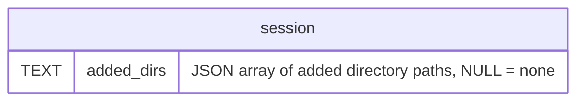

# Plan: See added directories

**Created**: 2026-10-19
**Status**: completed
**Work Type**: full-stack
**E2E Scope**: new-specs
**Fixture plan**: added-dirs.spec.ts daemon (one criterion restarts the daemon and asserts the list survives)
**Features**: focus, card-location
**Touches**: usage, lifecycle, connection, rail, groups, actions, tiles, launch
**Description**: Show a live session's added directories, with each one's branch, in the Focus header (closes #93 #101)

## Overview

A Claude Code session can work in directories beyond the one it was launched in: `/add-dir`,
the `--add-dir` flag and `permissions.additionalDirectories` in settings all add one. Today
nothing in Muster shows them, so the developer loses track of what context a session already
has (#93, #101).

Every status-line post carries the session's full directory list as `workspace.added_dirs`, led
by the launch directory, from every source (kb:fact/added-dirs-in-status-line, guarded by
`TestAddedDirsInStatusLine`). The daemon reads it, drops the launch directory, persists the list
while the session is alive, and has the repo poll read each directory's branch the way it already
reads the launch directory's. The Session object gains `addedDirs`.

The Focus header's folder line gains a `+N` suffix while any directory is added (mockup option B).
Hovering the readout with the mouse opens a panel that replaces the readout's plain `title` on every
session: **Location** (the launch checkout, then where Claude is while it is elsewhere), then
**Added directories · N** with each directory's folder, branch and full path (mockup option A's
panel). The design authority is `plans/see-added-dirs/mockups/final.html`. The rail card and the
tile header do not change: the list is context for the one session being worked in, which is the
Focus view, and the card is already dense.

## Requirements

### Must Have
- [ ] REQ-1: The daemon reads `workspace.added_dirs` from every routed status post and sets the
  session's added directories to that list minus the launch directory, in the reported order,
  without duplicates. A post without the key leaves the list unchanged.
- [ ] REQ-2: Each added directory's path is absolute, cleaned and symlink-resolved, the same
  normalisation as `claudeLocation.directory`; an entry that is not absolute is resolved against
  the session's launch directory. The launch-directory entry is recognised after that
  normalisation (it arrives as `/tmp/…` while the launch directory is `/private/tmp/…`).
- [ ] REQ-3: A session's added directories are empty from launch and resume until its first
  status post that carries the key, and are emptied when the session dies (Stop, liveness death,
  reconcile finding the pane gone). A dead session never shows any.
- [ ] REQ-4: An alive session's added directories survive a daemon restart and a `/clear`.
- [ ] REQ-5: Each added directory carries the git reading of that directory — its checkout's
  top-level folder name, branch and worktree flag — refreshed on every repo-poll tick and at once
  when the list changes, `null` when it is not a git checkout or HEAD is detached. A directory
  that no longer exists keeps its last-known reading.
- [ ] REQ-5a: The git reading never gates the directory. A directory is on the wire, in the `+N`
  count and in the panel from the status post that reports it; its row shows the folder and path
  alone while `repo` is null (not read yet, not a git checkout, detached HEAD), and gains
  `· <branch>` on the `sessionUpsert` that carries the reading.
- [ ] REQ-6: The Focus header's folder line ends in `+N` (N = the number of added directories)
  while N > 0, in `--fg-muted`, and shows no suffix while N = 0. The suffix is never ellipsized:
  the folder name shortens before it does.
- [ ] REQ-7: Hovering the header's location readout with the mouse opens a panel (the existing
  `.pop` component) and leaving closes it; it replaces the readout's `title` attribute, which is
  removed. The panel shows a `Location` heading, a row for the launch checkout, a `↳` row for where
  Claude is while `claudeLocation` is non-null, and — while N > 0 — an `Added directories · N`
  sub-heading and one row per added directory in wire order. Each row is the folder name, then
  `· <branch>` when it has one, over the full path.
- [ ] REQ-8: The rail card, the tile header and their hovers are unchanged.

### Should Have
- [ ] REQ-9: The panel opens after the same hover delay as the rail header's group popover and
  never takes a click (it is `pointer-events: none`, appended to the body).

### Nice to Have
- (none)

## Protocol Contract

Delta against `docs/protocol.md`, `kb:anchor/ws.session` (merged there on approval;
`docs/features/card-location/contract.md` regenerates). `protocolVersion` is unchanged: the key is
additive and the dashboard is embedded in the same binary.

### The Session object — new required key `addedDirs`

```jsonc
  "addedDirs": [                     // required key, array, never null. The directories the session works in beyond its launch
                                     //   directory, from the status line's workspace.added_dirs (every source: /add-dir, --add-dir,
                                     //   settings), in reported order, launch directory removed, no duplicates.
                                     //   [] = none added, OR no status post has reported since the last launch/resume, OR !alive.
    { "directory": "/Users/bob/code/infra",                 // absolute, cleaned, symlink-resolved (as claudeLocation.directory)
      "repo": { "name": "infra", "branch": "main", "isWorktree": false } }   // object | null — name = basename of that
                                     //   directory's checkout top level; null when not a git checkout, HEAD is detached, or the repo
                                     //   poll has not read it yet (a newly reported directory is null until the next reading)
  ],
                                     //   INV: !alive ⇒ addedDirs == []. Set by every routed status post carrying the key; emptied by
                                     //   launch, resume and every death; kept by /clear and a daemon restart while alive.
                                     //   Each repo refreshed by the repo poll (alive sessions only); a missing directory keeps its
                                     //   last-known repo. Changes arrive as an ordinary sessionUpsert. Display-only — never read by
                                     //   the state machine.
```

No HTTP endpoint is added or changed.

## Schema Changes

Migration `0017_added_dirs.sql` (forward-only, additive):

```sql
ALTER TABLE session ADD COLUMN added_dirs TEXT;  -- JSON array of normalised directory paths; NULL = none
```

Only the paths persist; each directory's `repo` is re-read by the repo poll's start-up run, which
runs even with `-repo-poll 0` (kb:adr/lifecycle-branch-refreshed-by-repo-poll).

## Diagrams

`delta of kb:diagram/store-schema` — the `session` entity gains one line, and the prose's
"0001-0016" ranges become "0001-0017":



## UI Specifications

Governing docs: `docs/design/design-system.md` § "Focus mainhead" (the readout and its hover) and
the `.pop` hover popover the rail group header already uses; colours from §3 (neutral tokens only,
never a state colour — the mockups' teal is rejected for that reason). Reference render:
`plans/see-added-dirs/mockups/final.html`.

### Views
- Focus header (`#mainhead`) — the folder line `.repo .rf` gains a trailing `+N` span; the `.loc`
  readout loses its `title` and opens the location panel on mouse hover.
- Rail card, tile header — unchanged.

### User Flows
1. The developer runs `/add-dir ~/code/infra` in a focused session; on the next status post the
   folder line reads `muster+1`.
2. The developer rests the mouse on the readout; after the hover delay the panel opens under it,
   listing Location (`muster · feat-e2e` over the launch path) and `Added directories · 1` with
   `infra · main` over `/Users/bob/code/infra`.
3. Moving the mouse off the readout closes the panel.
4. Stopping the session removes the suffix; hovering shows Location only.

### States
- No data yet: `addedDirs` is `[]` — no suffix; the panel shows Location only. (Absence of the cue
  is accurate here: nothing is known to be added, so no "unknown" word is rendered.)
- Dead session: `[]` by INV — as above.
- Daemon down: the header keeps the last snapshot as it does today; the panel still opens on hover
  with the last-known values.

### Testable UI Elements

| Element | Role | Name / Text Pattern | Notes |
|---------|------|---------------------|-------|
| Added-directory count suffix | — | `+N`, e.g. `+2` | a span, last child of the header's `.repo .rf`; that line's `textContent` reads `muster+2` (no space, per `final.html`); absent (not hidden-empty) when N = 0 |
| Location panel | `tooltip` | — | `role="tooltip"` mandated (matches the group popover); appended to `document.body`; present only while open |
| Panel heading | — | `Location` | first heading line of the panel (rendered uppercase by CSS; `textContent` is `Location`) |
| Panel added sub-heading | — | `Added directories · N` | present iff N > 0 |
| Panel directory row | — | `<folder> · <branch>` over `<absolute path>` | `<folder>` alone when `repo` is null or has no branch; the launch row uses the session's `repo`, the `↳` row its `claudeLocation` |

### Invariants
- **INV-1**: `!alive ⇒ addedDirs == []` — asserted after every way a session dies (Stop, liveness
  death, reconcile at start) and from every source state (with and without directories, before and
  after a `/clear`, with other sessions present whose lists must be untouched).
- **INV-2**: the launch directory never appears in `addedDirs`, under any spelling of it
  (`/tmp/x` vs `/private/tmp/x`, trailing slash).
- **INV-3**: the header suffix shows iff `addedDirs.length > 0`, and its number equals the length.

## Affected Files

### Daemon (daemon-impl)
- `internal/claudecode/status.go` — REQ-1: the status interpretation reports `workspace.added_dirs`
  (present vs absent kept distinct) as a neutral list.
- `internal/session/status.go` — REQ-1, REQ-2, REQ-4: a routed status post sets the session's
  added directories (normalised, launch directory dropped, deduped) and nudges the repo poll when
  the list changes.
- `internal/session/session.go`, `internal/session/liveness.go`, `internal/session/actions.go`,
  `internal/session/reconcile.go` — REQ-3: launch/resume start the list empty; every death empties it.
- `internal/session/repo.go` — REQ-5: repo targets carry the added directories; a reading carries
  one repo per directory and is revalidated against the list as it stands at apply
  (kb:lesson/off-lock-reading-revalidated-at-apply).
- `internal/server/reporefresh.go` — REQ-5: the poll reads each added directory's checkout.
- `internal/server/sessionwire.go` — the `addedDirs` wire key.
- `internal/store/session.go`, new `internal/store/migrations/0017_added_dirs.sql` — REQ-4: the
  column, read and written with the row.

### Web (web-impl)
- `web/src/protocol/session.ts` — the `addedDirs` decode.
- `web/src/sessions/card.ts` — REQ-6, REQ-7: the header meta view-model gains the suffix count and
  the panel's rows (no DOM).
- `web/src/render/mainhead.ts`, new under `web/src/render/mainhead*.ts` — REQ-6, REQ-7, REQ-9: the
  suffix span, the `.loc` title removed, the hover panel.
- `web/src/style.css` — REQ-6, REQ-7: the suffix style and the panel's row rules.
- `web/index.html` — only if the static `.loc` markup needs a slot.
- `web/src/features/focus.ts` — one-line wiring of the panel controller, if it needs one.

### Existing tests this breaks
- web-tests: `web/src/render/mainhead.test.ts:502-542` — assert `.loc`'s `title` text; the title
  is removed (REQ-7), so these move to the panel's content.
- e2e-specs: `web/e2e/card-location.spec.ts:400-433` — asserts the header `.loc` `title`
  (lines 419 and 432); the rail `.r2` and tile assertions in the same test stay.
- daemon-tests: every Go fixture that builds a whole wire Session or compares a persisted row
  gains `addedDirs` / `added_dirs`; the impl log's `## Handoff` lists them.

## Edge Cases

1. A status post without `workspace` or without `added_dirs` (older version, partial post) leaves
   the list as it was. → D2
2. `added_dirs` holds only the launch directory → `[]`. → D1
3. The launch entry arrives as `/tmp/…` while the launch directory is stored resolved (or with a
   trailing slash) → still dropped. → D3
4. A relative entry → resolved against the launch directory. → D4
5. The same directory twice (once via a symlink) → listed once, first position kept. → D4 (shared with edge case 4)
6. `/clear`: the old id's `SessionEnd{reason:"clear"}` and the new id's `SessionStart` arrive in
   either order, and either may arrive after the new id's first status post → the list is
   untouched by both events (the session never died) and the next post re-reports it. → D6
7. A straggler status post from the previous turn arriving after the `/clear` rebind carries the
   same list (it survives `/clear`, kb:fact/added-dirs-in-status-line) → harmless overwrite. → D6 (shared with edge case 6)
8. A straggler status post arriving after the session died must not refill a dead session's list
   (status posts are routed only to alive sessions today; asserted, not assumed). → D7
9. Resume: the list starts empty; the first post brings back only directories saved to settings
   or passed by flag — session-only `/add-dir` entries are gone, matching Claude Code. → D5
10. Daemon restart while alive → list restored from the row; repos re-read by the start-up poll. → E4
11. Tmux pane death without `SessionEnd` → liveness death empties the list. → D5 (shared with edge case 9)
12. An added directory deleted while the session runs → kept in the list (Claude Code still reports
    it) with its last-known repo. → D9
13. A repo-poll reading taken before the list changed is applied after → repos for directories no
    longer listed are dropped, new ones stay null until the next reading. → D10
14. Hook loss: the list depends only on status posts, so a lost post delays it to the next post. → untested: loss is the absence of an input; D2 covers "absent leaves unchanged"
15. Many added directories → the panel lists all, each path wrapping inside `.pop`'s max width; past what
    fits below the readout it flips to the top of the viewport (over the header), and past the viewport
    the lower rows drop off, a known limit. → E2E (wave 3, review cycle 1)
    *Amended* (review cycle 1, browser Decision 1 → decisions/location-panel-overflow, outcome B;
    kb:adr/focus-location-panel-lists-every-row): was "the panel lists all … → W4"; W4 is the suffix
    check and never covered it.
16. A hover while the daemon is down → the panel opens with last-known values. → W5
17. A newly reported directory before the repo poll has read it, or one that is not a git
    checkout → listed with folder and path, no branch; the branch appears once read. → D15, E7

## Acceptance Criteria

### Daemon
- **D1**: A status post whose `added_dirs` is only the launch directory sets `addedDirs` to `[]`.
- **D2**: A status post with no `workspace.added_dirs` key leaves a non-empty `addedDirs` unchanged.
- **D3**: The launch directory is dropped from `added_dirs` whether it arrives symlinked (`/tmp` vs `/private/tmp`) or with a trailing slash.
- **D4**: Relative entries resolve against the launch directory, and duplicates after normalisation collapse to the first.
- **D5**: INV-1 holds after Stop, liveness death and reconcile, from each source state named in INV-1, with a second session's list untouched.
- **D6**: A `/clear` pair applied in either order, with a status post before or after each event, leaves `addedDirs` as the last post reported.
- **D7**: A status post routed after the session's death leaves `addedDirs` empty.
- **D8**: An alive session's `addedDirs` paths survive a store reload (daemon restart).
- **D9**: A repo-poll tick sets each added directory's `repo` to that checkout's name, branch and worktree flag, `null` for a non-checkout, and keeps the last-known `repo` for a directory that no longer exists.
- **D10**: A repo reading taken against an older list applies only to directories still listed.
- **D15**: The `sessionUpsert` a status post triggers lists a newly reported directory with `repo: null` before any repo reading of it, and no git read sits on the status path.
- **D11**: The status-line key `added_dirs` is read only in `internal/claudecode/`.

### Web
- **W1**: The folder line shows `+N` iff `addedDirs` is non-empty, N equal to its length (INV-3).
- **W2**: The header `.loc` carries no `title` attribute.
- **W3**: The panel model lists Location, the `↳` row only while `claudeLocation` is non-null, and the Added section only while N > 0, rows in wire order.
- **W4**: A long folder name ellipsizes before the `+N` suffix, which stays fully visible at the readout's floor.
- **W5**: The panel opens on hover with the last-known values while the WS is disconnected.

### E2E
- **E1**: A status post with two added git directories shows `+2` on the Focus header's folder line, and the rail card shows no suffix.
- **E2**: Hovering the header readout opens a `tooltip` listing `Location`, then `Added directories · 2` with each directory's folder, branch and path; moving away closes it.
- **E3**: Stopping the session removes the suffix and the panel's Added section.
- **E4**: Restarting the daemon while the session is alive keeps `+2` and the branches in the panel.
- **E7**: An added plain (non-git) directory counts in `+N` and shows in the panel as its folder and path with no branch.
- **E5**: A checkout of a new branch in an added directory shows in the panel within one repo-poll tick.

### Automated Checks

```checks
D12 make test
D13 make lint
D14 go build ./...
D11 ! rg -n '"added_dirs"' cmd/ internal/ --glob '!internal/claudecode/**' --glob '!**/*_test.go'
W6 make web-test
W7 make web-build
W8 make web-lint
W9 make contrast
E6 make e2e
K1 make check-kb
```

D11's grep excludes `_test.go` files: daemon tests that drive a status post need the wire key, and
they obtain whole payloads the way existing status tests do.

### Reviewer-Verified

- **R1**: The suffix and the panel use neutral tokens only (`--fg-muted`, `--fg-dim`, `--fg`), never a state colour.
- **R2**: The panel matches `plans/see-added-dirs/mockups/final.html` row for row in each of its six states.
- **R3**: No `any` types in new web code.

## Doc Delta

**card-location** — becomes true:
- `docs/features/card-location/spec.md` has an `## Added directories` section saying: the session's
  added directories come from every status post's `workspace.added_dirs`, launch directory removed,
  normalised like Claude's directory; they are empty until the first such post after a launch or
  resume and on every dead session, kept by `/clear` and a daemon restart; each directory's git
  reading is refreshed by the repo poll, and a missing directory keeps its last one.
- Its closing line names the Focus header as the only surface that renders `addedDirs`.

**card-location** — stops being true:
- nothing (no current sentence is contradicted; the frontmatter summary gains "and the directories
  added to it").

**focus** — becomes true:
- `docs/features/focus/spec.md` says the folder line ends in `+N` while directories are added, and
  that hovering the readout with the mouse opens a panel listing the location, where Claude is
  while moved, and each added directory with its branch and path.

**focus** — stops being true:
- "The session name and the repo readout carry hover text (the name's is its full title; the
  readout's is the launch path and branch, plus where Claude is when it has moved)." becomes "The
  session name carries hover text (its full title); the repo readout opens the location panel."

**design-system** (orchestrator's Doc-Upkeep Backstop) — `docs/design/design-system.md` § "Focus
mainhead": "The location group carries a hover `title` …" is replaced by the panel sentence above.

## Out of scope

- Showing added directories on the rail card or the tile header.
- Keyboard access to the location panel (mouse only, the developer, 2026-10-19).
- Adding `addedDirs` to the issue-capture allowlist.

## Implementation Notes

**Hints (non-binding):**
- `deriveLocation`, `resolvePath` and `topLevel` in `internal/server/reporefresh.go` already do the
  per-directory normalisation and git read the added directories need.
- `web/src/render/grouppopover.ts` is the existing hover-popover controller (delay, `placeAnchored`,
  body-appended `role="tooltip"`); its focus-to-open path is not wanted here.
- `web/src/sessions/card.ts`'s `locationHover` stays for the tile `.wh` hover (REQ-8).
- `claudeLocation`'s persistence (`claude_dir`, migration 0012) is the pattern for the new column.

**Decisions** (each a `proposed` ADR at approval):
- `kb:adr/lifecycle-added-dirs-from-status-line-cleared-on-death` — the list comes from the status
  line, not the `DirectoryAdded` hook (which misses flag and settings directories and does not
  re-fire after `/clear`); a dead session shows none. Claude Code's list does not say which entries
  were session-only, and a resume re-reports the ones that survive, so emptying on death is the
  only way never to show a directory that is no longer added. A resumed session sends its first
  status post at once, before any prompt (kb:fact/resume-restores-model-and-mode-except-plan), so
  the surviving entries reappear within moments of a resume. Each directory's branch comes from
  the repo poll.
- `kb:adr/focus-added-dirs-folder-suffix-and-location-panel` — a `+N` suffix on the folder line in
  `--fg-muted`, and a mouse-hover `.pop` panel that replaces the readout's `title` on every session;
  rail card and tile header unchanged.

**Facts relied on:** kb:fact/added-dirs-in-status-line (verified 2.1.301..canary, guarded by
`TestAddedDirsInStatusLine`; measured in the same managed-session configuration production uses, so
it carries over as is), kb:fact/cwd-follows-claude-mid-session (entries are paths as typed,
unresolved), kb:fact/status-posts-arrive-in-pairs (a repeated post is a no-op by value).

**Doc upkeep (orchestrator):** the Doc Delta above; the store-schema diagram delta; move the #93
and #101 entries from `TODO.md` to `docs/history/todo-done.md`.
