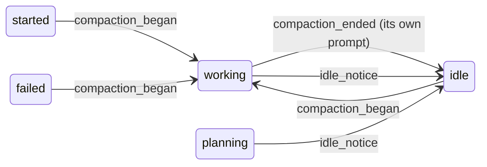

# Plan: State Issues

**Created**: 2026-10-12
**Status**: completed
**Work Type**: daemon
**E2E Scope**: new-specs
**Fixture plan**: state-transitions.spec.ts fileDaemon (each test launches and drives its own title-scoped session; no rail order, count or other daemon-global state is asserted)
**Features**: lifecycle, ingest
**Touches**: focus, canary
**Description**: Fix the card-state edge cases measured on 2026-10-12: idle_prompt never raises needs_input, compaction reads working and ends idle, a subagent's mode and failure stay the subagent's, and the early-Esc gap is accepted on record.

## Overview

On 2026-10-12, an interface probe (Claude Code 2.1.296) and a read-only replay of the
developer's live event log traced the seven card-state issues (#65, #66, #70, #72, #78, #86, #87) to five causes.

1. **`idle_prompt` raises `needs_input`.** That mapping comes from the first UX design, before
   anything was measured. The closed-prompt guard later made an `idle_prompt` after a normal turn
   inert. What is left fires only on prompts no hook ever closes, and every such case is a false
   alarm:
   - a local slash command such as `/context` (kb:fact/local-command-orphan-idle-prompt; 2 live
     cases that day, one of them `/rc`, #87);
   - a compaction (kb:fact/compact-hook-sequence);
   - a background-subagent stretch under a fresh prompt id (kb:fact/background-subagent-fresh-prompt-id).

   In the background case, the wait is recorded as the main agent's. The subagent's activity is
   "another agent", so it can never clear the wait, and the card is stuck at needs input while
   background work runs (#72). The ADR scopes ownership to **permission** waits
   (kb:adr/lifecycle-attention-owned-by-raising-agent); the code applies it to idle waits too.
   **Fix:** an `idle_prompt` never raises `needs_input`. On an open turn it is the turn's end and
   lands `idle`; otherwise it only closes the prompt it names. Ownership applies to permission
   waits only.
2. **Compaction.** `/compact` sends `PreCompact`, then `SessionStart{source:"compact"}`, with no
   `UserPromptSubmit` or `Stop`. The card reads idle while compaction runs (#65), then `started`
   (#66): the `SessionStart` is handled as a plain bind. **Fix:** a compaction begun outside a turn
   reads `working` (the developer's choice, over a new state), and its `SessionStart` lands `idle`.
   A mid-turn (auto) compaction changes no state.
3. **Esc before any output**, including during API retries, and an interrupted compaction put the
   prompt back in the input box and leave no hook, transcript line, `idle_prompt` or status-line
   change (kb:fact/interrupt-before-output-leaves-no-trace). The card reads `working` until the
   next prompt (#78). The developer has decided to **accept** this gap and close #78 with this
   work. Nothing in the code changes; the decision and its reason go on record. The live log held
   3 such cases that day.

4. **A subagent's permission mode is latched as the session's.** A subagent whose definition
   declares a mode reports that mode on its hooks. The built-in `claude-code-guide` declares
   `dontAsk`, even under a plan-mode parent (kb:fact/subagent-declared-mode-on-hooks). Muster
   latches the mode from every event, so a plan-mode session reads `working` as soon as such an
   agent acts, with no plan approved (#70; its snapshot's mode was `dontAsk`). **Fix:** only the
   main agent's events move the latch.
5. **A subagent's failure fails the session.** A background subagent whose API call fails emits
   `StopFailure` with its `agent_id`, on the parent's already-closed prompt
   (kb:fact/subagent-stopfailure-carries-agent-id). Muster reads it as the session's turn
   failing, and the card reads `failed` while Claude sits idle (#86). **Fix:** a subagent-marked
   `StopFailure` changes no state. The main agent learns of the failure through its
   background-completion turn, whose own end Muster already follows.

Approving a plan mid-turn is still a real mode change: the rest of that turn is `acceptEdits`
(kb:fact/subagent-hooks-carry-parent-permission-mode), and that keeps reading `working`.

## Requirements

### Must Have
- [ ] REQ-1: An `idle_prompt` `Notification` never moves a session to `needs_input` and never sets `attention`, from any source state.
- [ ] REQ-2: An `idle_prompt` whose `prompt_id` is not closed, arriving while the session is `working` or `planning`, closes that prompt and the current one, and lands `idle`. As with a `Stop`, it clears `attention` and `failure` and sets `unread` iff no terminal client is attached. `lastActivity` and `backgroundTasks` are unchanged.
- [ ] REQ-3: An `idle_prompt` whose `prompt_id` is not closed, arriving in `started`, `idle` or `failed`, closes that prompt and changes no state or other field. In `needs_input` it does the same when the wait's reason is `permission`, and the wait is kept. A wait with reason `idle` (only a row persisted by an earlier daemon can hold one) lands `idle` as in REQ-2.
- [ ] REQ-4: An `idle_prompt` with no `prompt_id`, or with a closed one, changes nothing (unchanged behaviour, kept).
- [ ] REQ-5: Turn activity from another agent keeps a `needs_input` wait only when the wait's reason is `permission`. Any turn activity ends a wait with reason `idle`, as an ordinary open-turn event does: → `ACTIVE`, `attention` and `failure` cleared.
- [ ] REQ-6: A `PreCompact` arriving while the session is `started`, `idle` or `failed` adopts its `prompt_id` as current and moves the session to `working`, never `planning`, whatever the permission-mode latch reads. It clears `attention` and `failure`, and counts the compaction as today.
- [ ] REQ-7: A `PreCompact` arriving in `working`, `planning` or `needs_input` (an auto-compaction inside a turn) only counts the compaction: no transition, and the turn's current prompt is unchanged.
- [ ] REQ-8: A `SessionStart{source:"compact"}` whose `prompt_id` is the prompt a REQ-6 compaction opened, while that prompt is still current and open, closes it and lands `idle`. `unread` follows the REQ-2 rule. `lastActivity`, `lastPrompt`, `context`, `compactions` and `backgroundTasks` are unchanged.
- [ ] REQ-9: Any other `SessionStart{source:"compact"}` changes no state and no state-machine field. This covers a mid-turn compaction, a lost `PreCompact`, and a stale one after the turn already closed. Its binding effect is the ordinary bind's: a `session_id` different from the bound one still escalates to the clear-rebind (kb:adr/ingest-envelope-authoritative-binding). *Amended (decisions/compact-sessionstart-left-id, review cycle 1):* a `session_id` this session has already left is a reordered straggler — routed and applied with no rebind, by `Apply`'s monotonic guard (kb:adr/ingest-monotonic-rebind), never by the compaction arm.
- [ ] REQ-10: `SessionStart` with source `startup`, `clear` or `resume`, and a missing source, behave exactly as today.
- [ ] REQ-12: An event carrying the subagent marker never changes the permission-mode latch (`permissionMode` / its source), whatever `permission_mode` it carries. Main-agent events latch exactly as today.
- [ ] REQ-13: A `StopFailure` carrying the subagent marker changes no state and no state-machine field: no transition, no `failure`, no prompt closed. An unmarked `StopFailure` behaves exactly as today.

### Should Have
- [ ] REQ-11: The interrupt sweep's scope is unchanged (`working`/`planning`/`needs_input` with an open current prompt). An open compaction prompt is inside it and never matches an interrupt line, which needs no special case.

### Nice to Have
- Nothing.

## Protocol Contract

No new message, endpoint or field. The delta is to `docs/protocol.md`'s state-machine prose and its
Session object comments:

- `kb:anchor/state.transitions`:
  - The `Notification` `idle_prompt` (prompt not closed) row is replaced by the REQ-2/REQ-3 behaviour.
  - The `Notification` `permission_prompt` / `idle_prompt` (prompt already closed) row becomes `permission_prompt` only, plus REQ-4's no-op for `idle_prompt`.
  - The `PreCompact` row becomes REQ-6/REQ-7.
  - A new row covers `SessionStart` (`source:"compact"`): REQ-8/REQ-9.
  - The `SessionStart` (`source:"startup"`) row says it covers a missing source too.
  - The "Turn-activity event, state `needs_input`, event's agent ≠ `attentionAgent`" row is qualified to `attention.reason:"permission"`.
  - The `StopFailure` row is qualified to an unmarked `StopFailure`. A new row says a subagent-marked `StopFailure` persists only, with no transition and no field change (REQ-13).
- `kb:anchor/state.tracked`: `modeLatch` is "overwritten by any **main-agent** payload carrying the field". Subagent-marked events never move it, because a subagent may run under a mode its definition declares (REQ-12, kb:fact/subagent-declared-mode-on-hooks).
- `kb:anchor/state.transitions`, closing paragraph: `needs_input` exits as today. A new sentence
  says the turn ends no hook marks: an Esc before any output (API retries included) and an
  interrupted compaction leave the card in `working` until the next prompt
  (kb:fact/interrupt-before-output-leaves-no-trace).
- `kb:anchor/ws.session`: the `attention` comment says reason `"idle"` is no longer raised. Only a
  row persisted by an earlier daemon can still carry it, until that session's next transition.
  The enum keeps `"permission"|"idle"` on the wire, so clients need no change.

## Schema Changes

No schema changes required. Any marker that a compaction opened the current prompt may live in
memory: a daemon restart during the ~10 s compaction loses it, and the 60 s `idle_prompt` then ends
the turn (REQ-2). That is the implementer's choice.

## Diagrams

A delta of the inline state diagram in `docs/features/lifecycle/spec.md` (not a kb diagram record). The
`needs_input_idle` arrows into `needs_input` go. New arrows `active --> idle : idle_notice` and
`needs_input --> idle : idle_notice (legacy idle wait)` arrive, and a compaction pair:



## UI Specifications

No UI change. The card already renders `working` and `idle`, and the `idle` attention reason's copy
stays for legacy rows.

### Testable UI Elements

| Element | Role | Name / Text Pattern | Notes |
|---------|------|---------------------|-------|
| A rail card's state badge | — | `working` / `idle` / `needs input` (case-insensitive) | existing `stateBadge(card)` helper in `web/e2e/helpers/session.ts` |

### Invariants

- **INV-A** (existing, re-crossed): `attention` is non-null iff state is `needs_input`, and
  `failure` is non-null iff state is `failed`, after every input from every source state.
- **INV-B** (new): no `idle_prompt` input, from any of the six source states with or without a
  `prompt_id` and with the prompt open, closed or unseen, ever results in `needs_input` unless the
  source state already was `needs_input`, and none ever raises or re-stamps a wait. *Amended
  (daemon-tests report, 2026-10-13):* "with reason `permission`" dropped. A legacy `idle` wait
  left alone by a REQ-4 no-op stays `needs_input`, as REQ-4 requires.
- **INV-C** (new): no compaction input (`PreCompact`, `SessionStart{source:"compact"}`), from
  any source state, results in `started` — for a compact `SessionStart` carrying the bound
  `session_id`. *Amended (e2e-specs authoring report, 2026-10-12):* one carrying a different
  `session_id` is REQ-9's clear-rebind and lands `started` as every rebind does; INV-C does not
  cover it.
- **INV-D** (existing, re-crossed): `unread` ⇒ state is `idle`.

Each is asserted by an input × source-state table (`D3`), not per transition
(kb:lesson/invariant-missed-by-per-transition-tests).

## Affected Files

### Daemon (daemon-impl)
- `internal/claudecode/interpret.go` — REQ-13: a `StopFailure` says whether a subagent sent it, as the turn-activity events already do. REQ-8/REQ-9/REQ-10: `SessionStart{source:"compact"}` becomes an input of its own instead of a plain bind. REQ-1–REQ-4: what `idle_prompt` means changes from "needs input" to "Claude is at its input box".
- `internal/session/machine.go` — REQ-1–REQ-9: the `idle_prompt`, `PreCompact` and compact-`SessionStart` arms. REQ-12: the latch ignores subagent events. REQ-13: a subagent's `StopFailure` is inert.
- `internal/session/session.go` — REQ-5: who owns a wait is consulted only for a permission wait. REQ-8: whatever marks a prompt as a compaction's.
- `internal/session/apply.go` — REQ-2/REQ-8: the new turn-closing inputs set `unread` as `Stop` does. REQ-9: the compact bind is handled as a binder by the envelope rebind check.

### Existing tests this breaks
- daemon-tests: `internal/session/machine_test.go:477-501` (`TestApplyInput_NeedsInputIdle_FromFailedViaUnseenFreshPromptClearsFailure`) — expects `needs_input`/`idle`.
- daemon-tests: `internal/session/machine_test.go:~642,~728-732` — idle-notice rows expecting `needs_input` with reason `idle`.
- daemon-tests: `internal/session/machine_turnstate_test.go:~68-96, ~481, ~548` — idle-notice rows.
- daemon-tests: `internal/session/rail_unread_test.go:45-46` — the `needs_input_idle_*` rows.
- daemon-tests: `internal/claudecode/interpret_test.go:121, 431` — the kind an `idle_prompt` and a `SessionStart{compact}` interpret to.
- e2e-specs: `web/e2e/sessions.spec.ts:447` (E14), only if it asserts no transition from a `PreCompact` on a fresh session; the impl log's `## Handoff` confirms.

## Edge Cases

1. `PreCompact` lost: `SessionStart{compact}` arrives on an `idle` card and changes nothing (REQ-9). → D2
2. `SessionStart{compact}` lost: the card reads `working` until the `idle_prompt` 60 s later names the compaction's prompt and lands `idle` (REQ-2). → D2 (shared with edge case 1)
3. `SessionStart{compact}` arrives before its `PreCompact` (reordered): it is not the current compaction prompt, so it is a no-op (REQ-9). The later `PreCompact` opens `working`, and the `idle_prompt` closes it. → D2 (shared with edge case 1)
4. Empty compaction ("Not enough messages"): `PreCompact` only, then the `idle_prompt` closes it after 60 s (measured 1 of 1). → D2 (shared with edge case 1)
5. Interrupted compaction: `PreCompact` only, and no `idle_prompt` (measured 0 of 1). The card reads `working` until the next prompt: the accepted gap, as #78. → untested: no event exists to drive; recorded as the accepted-gap ADR
6. Auto-compaction inside a turn: `PreCompact` in `working`, so no transition (REQ-7). Its `SessionStart{compact}` is not a REQ-6 prompt, so no transition (REQ-9). The turn's own `Stop` ends it. → D2 (shared with edge case 1)
7. A compaction prompt still open when a new `UserPromptSubmit` arrives (fresh id): an ordinary new turn, unchanged. → D3
8. A daemon restart mid-compaction loses the in-memory marker. `SessionStart{compact}` is then a no-op and the `idle_prompt` ends the turn (REQ-2). → untested: needs a restart inside a 10 s window; REQ-2's own test covers the exit
9. A background subagent's fresh-id stretch, then an `idle_prompt` naming that id: `idle`. A later subagent-marked event on the now-closed prompt moves the card back to `ACTIVE`, as today (kb:adr/lifecycle-subagent-marked-events-not-stragglers). → D2 (shared with edge case 1)
10. A permission wait raised by a subagent, then an `idle_prompt` naming an open prompt: the wait is kept (REQ-3). → D2 (shared with edge case 1)
11. A legacy row persisted as `needs_input`/`idle`, then subagent-marked activity: → `ACTIVE` (REQ-5). → D2 (shared with edge case 1)
12. The `/clear` pair: `SessionEnd(clear)` and `SessionStart(clear)` are unchanged. A prompt-less `idle_prompt` after `/clear` changes nothing (REQ-4). A straggler `idle_prompt` from the previous conversation carries a closed prompt id (closed ids survive the clear-rebind) and changes nothing. → D2 (shared with edge case 1)
13. A straggler `idle_prompt` for a prompt already closed by `Stop` arrives after the next turn started: closed, so a no-op (REQ-4). → D2 (shared with edge case 1)
14. A `SessionStart{compact}` on a different `session_id` (lost binding) escalates to the clear-rebind as any bind does (REQ-9). → D2 (shared with edge case 1)
15. A plan-mode session in `planning`: a subagent-marked event carrying `dontAsk` (or any mode) keeps `planning` and the latch at `plan` (REQ-12). → D2 (shared with edge case 1)
16. A subagent-marked `StopFailure` arrives while the main turn is still open (`working`): the session stays `working` (REQ-13). → D2 (shared with edge case 1)
17. A subagent-marked `StopFailure` while a permission wait is open: the wait and `needs_input` are kept (REQ-13). → D2 (shared with edge case 1)
18. The main agent's background-completion turn then fails with an unmarked `StopFailure`: `failed`, as today. → D2 (shared with edge case 1)

## Acceptance Criteria

### Daemon
- **D1**: `make test` passes.
- **D2**: Every numbered edge case pinned to D2 has a unit test in `internal/session` driving that event sequence through the state machine and asserting the resulting state and fields.
- **D3**: A table test crosses each of `idle_prompt` (no id / open id / closed id / unseen id), `PreCompact`, `SessionStart{compact}` (own prompt / other prompt), and a subagent-marked `StopFailure` and turn-activity event (carrying a non-plan mode) with all six source states (with `needs_input` both `permission`-owned by main, `permission`-owned by a subagent, and legacy `idle`), and asserts INV-A, INV-B, INV-C and INV-D after each.
- **D4**: `internal/claudecode` unit tests assert that `SessionStart` with `source:"compact"` interprets to an input distinct from the startup bind, and that `startup`, `clear`, `resume` and a missing source interpret as today.
- **D8**: `internal/claudecode` unit tests assert that a `StopFailure` with an `agent_id` interprets as from a subagent, and one without as from the main agent.
- **D5**: `make lint` passes.
- **D6**: `go build ./...` passes.

### E2E
- **E1**: Synthesized hooks: a session that finished a turn (`idle`) gets a `PreCompact`, and its card badge reads `working`; then `SessionStart{source:"compact"}` with the same `prompt_id`, and the badge reads `idle`.
- **E2**: Synthesized hooks: an `idle` card gets an `idle_prompt` carrying a `prompt_id` no other hook named, and the badge stays `idle`, never `needs input`.
- **E3**: Synthesized hooks: a `working` card (after a `UserPromptSubmit`) gets an `idle_prompt` carrying that turn's `prompt_id`, and the badge reads `idle`.
- **E4**: Synthesized hooks: a card in `needs input` from a `PermissionRequest` gets an `idle_prompt` for the same open prompt, and the badge still reads `needs input`.
- **E5**: Synthesized hooks: a session launched in plan mode reads `planning` after a `UserPromptSubmit` with `permission_mode:"plan"`, and still reads `planning` after a subagent-marked `PreToolUse` carrying `permission_mode:"dontAsk"`.
- **E6**: Synthesized hooks: an `idle` card (after a `Stop`) gets a subagent-marked `StopFailure` for the same prompt, and the badge still reads `idle`, never `failed`.

### Automated Checks

```checks
D1 make test
D5 make lint
D6 go build ./...
K1 make check-kb
E1 make e2e
```


### Reviewer-Verified
- **D2**: each D2-pinned edge case has its own test, read against the list above.
- **D3**: the table crosses every listed input with every listed source state.
- **D4**: the interpret tests cover all four `SessionStart` sources plus a missing one.
- **D7**: `internal/session` branches only on the neutral input kinds `internal/claudecode` derives; no new code there compares a Claude Code event name, notification type or `source` value.

## Doc Delta

**lifecycle** — becomes true (`docs/features/lifecycle/spec.md`):
- Inputs: "`PermissionRequest` and a `permission_prompt` enter `needs_input`. An `idle_prompt` never does: naming an open prompt of a `working` or `planning` session, it ends the turn into `idle` like `Stop`; otherwise it only closes that prompt (kb:fact/local-command-orphan-idle-prompt)."
- Inputs: "A `PreCompact` outside a turn enters `working` and its compact `SessionStart` lands `idle`; inside a turn it only counts (kb:fact/compact-hook-sequence)."
- Inputs: "An Esc before any output leaves the card `working` until the next prompt (kb:fact/interrupt-before-output-leaves-no-trace)."
- Inputs: "Only main-agent events move the mode latch; a subagent's `StopFailure` changes nothing (kb:fact/subagent-declared-mode-on-hooks)."
- The machine diagram carries the Diagrams delta above.

**lifecycle** — stops being true:
- Inputs: "Notification `permission_prompt` and `idle_prompt`, and `PermissionRequest`, enter `needs_input` (kb:fact/notification-types-observed); an `idle_prompt` with no prompt id follows `/clear` and changes nothing (kb:fact/clear-idle-prompt-carries-no-prompt-id)."
- Inputs: "`PreCompact` increments the compaction counter."
- Inputs: "Observed values include `bypassPermissions` (kb:fact/bypass-permission-mode-on-wire)." (the protocol's mode enum already lists it)
- The machine: "Only the interrupt and turn-activity arms guard on the source state; every other arrow is drawn from every state."
- The machine: "compaction, death_hint, clear_death_hint and inert change no state." becomes "death_hint, clear_death_hint and inert change no state."
- The machine: "A closed-prompt needs_input_idle always returns early; see Ordering for the other closed-prompt inputs."
- The `needs_input_idle` arrows in the machine diagram.

**protocol.md**: as the Protocol Contract section above.

## Out of scope

- Detecting an Esc before any output (#78). No hook, transcript line, `idle_prompt`, status-line field or pane title marks it, and reading the terminal is barred by the hard rule. The gap is accepted and #78 closes with this plan.
- Registering `PostCompact` in production settings: `SessionStart{source:"compact"}` already marks the end.

## Implementation Notes

**Hints (non-binding):**
- `KindNeedsInputIdle`'s callers and tests are listed under Existing tests. Renaming the kind to say what it now means is the implementer's call.
- `closesTurn` in `internal/session/apply.go` already decides `unread` for `Stop` and the interrupt. The new closing inputs belong beside them.
- `isBindKind` in `apply.go` guards the envelope rebind. A compact-bind input must be treated as a binder there, or the rebind check runs twice.
- The live log showed background subagents' hooks under a fresh unopened `prompt_id` (kb:fact/background-subagent-fresh-prompt-id). Today's adoption of an unseen id as current already handles it; REQ-2 gives such a stretch an exit.

**Facts handled:** kb:fact/subagent-declared-mode-on-hooks, kb:fact/subagent-stopfailure-carries-agent-id, kb:fact/compact-hook-sequence, kb:fact/local-command-orphan-idle-prompt,
kb:fact/permission-wait-gets-no-idle-prompt, kb:fact/background-subagent-fresh-prompt-id,
kb:fact/interrupt-before-output-leaves-no-trace, kb:fact/clear-idle-prompt-carries-no-prompt-id,
kb:fact/notification-types-observed, kb:fact/subagent-hooks-carry-parent-permission-mode.

**Carried-over measurements:** every fact above was measured on 2.1.296, the version this plan
targets. The idle_prompt delay (~60 s) is from kb:fact/notification-types-observed (2.1.233..canary),
re-checked 2026-10-12 on 2.1.296 at 60.0–60.04 s: still valid.

**Decisions (proposed ADRs at approval):**
- `lifecycle-idle-prompt-ends-turn-never-attention` — `idle_prompt` never raises `needs_input`; on an open turn it ends the turn into idle.
- `lifecycle-compaction-reads-working` — a compaction begun outside a turn reads `working` and its compact `SessionStart` lands `idle`; inside a turn it only counts.
- `lifecycle-mode-latch-main-agent-only` — only main-agent events move the permission-mode latch; a subagent's declared mode is its own.
- `lifecycle-subagent-stopfailure-not-session-failure` — a subagent-marked `StopFailure` changes no state.
- `lifecycle-early-interrupt-gap-accepted` — an Esc before any output is not detected; the card reads working until the next prompt, and no terminal-derived signal is added.

**Doc upkeep (orchestrator):**
- `docs/design/ux-flows.md` "States and ordering" table: the `Needs-Input` row's source becomes `PermissionRequest` / `Notification` `permission_prompt` only.
- Closing the issues: the `/land` subject carries `closes #65, closes #66, closes #70, closes #72, closes #78, closes #86, closes #87`.
- Each fact the new canary runs guard (`compact-hook-sequence`, `local-command-orphan-idle-prompt`, `interrupt-before-output-leaves-no-trace`) already names its guard on `main`.
